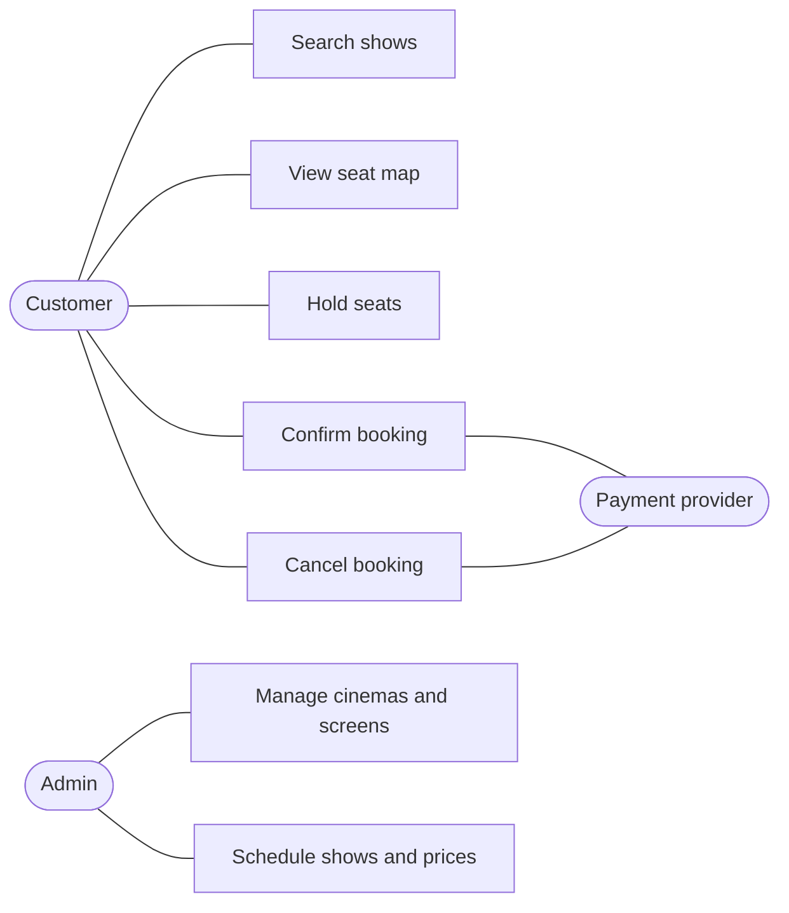

# Requirements and scoping

LLD prompts are deliberately vague: "design a parking lot", "design a movie booking system". The first five to eight minutes turn that one line into a bounded problem with a written list of requirements, an explicit scope line, and stated assumptions. Everything designed afterwards is judged against that list, so a missing or wrong requirement costs more than any modeling mistake.

This note covers the process, a clarifying question bank, actors and use cases, drawing the scope line, stating assumptions, and which non-functional constraints belong in an LLD round.

All examples use one domain: a movie ticket booking system with cinemas, screens, shows, seats, and bookings.

## From prompt to bounded problem

The phase has five steps, and each produces something that gets written down:

1. Identify the actors: who uses the system, and what external systems it talks to.
2. List the use cases: what each actor needs to do, in verb–object form ("book seats", "cancel booking").
3. Ask about the rules: the business constraints that shape the model, such as seat categories, hold times, and cancellation policy.
4. Draw the scope line: which use cases are in, which are out, and which are deferred as extensions.
5. State the assumptions: every answer the interviewer did not give, written as a decision that can be corrected.

The output fits on a few lines of the whiteboard or the top of the shared editor. It stays visible for the rest of the round and is the reference point when a design choice is questioned.

## Clarifying question bank

Grouped by what the answer changes in the design. Pick the few that matter for the prompt at hand .. asking all of them wastes the time box.

Actors and access:

- Who are the users? Customers only, or also cinema staff and admins?
- Do users need accounts, or can a guest book?
- Which external systems exist (payment provider, notification service)? These become interfaces, not classes to design.

Core flows:

- What is the main flow, end to end? For booking: search, pick a show, pick seats, pay, receive a ticket.
- Can one booking cover multiple seats? Multiple shows?
- Is cancellation supported, and does it refund?

Business rules:

- Are there seat categories (regular, premium, recliner) with different prices?
- Is pricing fixed per category, or does it vary by show time, day, or demand?
- How long can seats be held during checkout before they are released?
- Are there limits, such as a maximum number of seats per booking?

Edge cases and failure:

- What happens if payment fails after seats are held?
- What happens if a show is cancelled after bookings exist?
- Two customers select the same seat at the same moment. Who gets it?

Scale within one process:

- Roughly how many shows and seats are active at once? The answer picks data structures, not infrastructure.
- Is concurrent access in scope? In booking problems, the answer is almost always yes.

Extension probes, asked to learn what the interviewer is likely to add later:

- Are coupons or loyalty discounts planned?
- Are other event types (concerts, sports) planned on the same platform?

A useful pattern for each question is to offer a default at the same time: "Is there a seat hold during checkout? Assuming ten minutes unless there is a different rule." This keeps the round moving and turns every question into a proposed decision.

## Worked example: the booking prompt

Prompt: "Design a movie ticket booking system."

Questions asked, with the answers given or assumed:

- Users: customers book, admins set up cinemas, screens, and shows. Guests cannot book, so an account is required.
- Main flow: search shows by city, movie, and date, view the seat map, select seats, pay, and receive a booking confirmation.
- Seats: each screen has a fixed layout of seats in categories (regular, premium). Price depends on category and is set per show.
- Holds: selected seats are held for ten minutes during checkout. If payment does not complete, they are released.
- Payment: an external provider. The system calls it and receives success or failure.
- Cancellation: allowed up to two hours before the show, with a full refund.
- Concurrency: many customers book at once, and a seat must never be sold twice.

## Actors and use cases

Actors are roles, not people or classes. One person can be both a customer and an admin, and the payment provider is an actor because the system interacts with it.



On a whiteboard the same thing is a list of actors, each with its use cases underneath is enough.

Use cases split into two groups, and the split sets the order of work:

- Primary: the flow the system exists for. Here, search → view seats → hold → confirm. This is designed and coded first.
- Supporting: set-up and maintenance flows such as managing cinemas and scheduling shows. These are usually acknowledged, modeled at the class level, and left uncoded.

## Drawing the scope line

The scope line lists what is in, what is out, and what is deferred to extensions. Three rules decide where an item goes:

- The primary flow is always in.
- An item is out if it adds work without changing the model. User registration, login, and email templates are real features, but a design with them looks the same as one without.
- An item is deferred, not dropped, if the interviewer is likely to ask for it later. Name it so the design can leave a seam for it.

For the booking system:

- In scope: search shows, seat map with availability, seat holds with expiry, booking confirmation after payment, cancellation with refund, admin set-up of cinemas, screens, shows, and prices.
- Out of scope: authentication, the payment provider's internals, notifications, reviews and ratings, recommendations.
- Deferred extensions: coupons and discounts, dynamic pricing, other event types.

Writing the out-of-scope list is as important as the in-scope list. It prevents the interviewer from assuming a feature is part of the design, and it shows judgment about what matters.

## Stating assumptions

An assumption is a decision made in place of an answer. Writing it down makes it cheap for the interviewer to correct early, before the design depends on it. Numbering assumptions lets later design choices refer back to them.

For the booking system:

- A1. A seat belongs to one screen, and the layout of a screen does not change once shows are scheduled.
- A2. A booking covers one show and one or more seats.
- A3. A hold lasts ten minutes and is released automatically if not confirmed.
- A4. Price is fixed per seat category per show at the time the seats are held.
- A5. Payment is synchronous from the system's point of view: one call returns success or failure.
- A6. Everything runs in one process with in-memory storage.

Good assumptions are specific enough to design against. "Payments are handled externally" is too vague. A5 fixes the interaction style, which decides whether the design needs a pending-payment state.

## Non-functional constraints at this level

Non-functional requirements matter in LLD only when they change the class design. The line between LLD and high-level design runs roughly as follows.

In scope for LLD:

- Concurrency within a process. Two customers holding the same seat is the defining problem of booking systems. The design must say where the check-then-act happens and how it is made atomic ([note 13](13-concurrency.md)).
- Extensibility. New seat categories, pricing rules, or event types should arrive as new classes, not edits to existing ones. This decides where interfaces go.
- Data structure choice. A seat map queried by seat ID needs a `dict`, and finding the next expiring hold needs a heap or a sorted structure. These are LLD decisions.
- Time-based behavior. Hold expiry needs a clock the code can be tested against, so time is passed in or injected rather than read from `datetime.now()` inside the domain.
- Consistency of the model. A booking must never point at a released hold, and a seat must never be both held and booked. These are rules the classes enforce.

System design territory, acknowledged but not designed:

- Horizontal scaling, sharding by city or cinema, and replication.
- Availability targets and failover.
- Caching tiers, CDNs, and read replicas for search.
- Distributed locking or database-level concurrency control across servers.
- Queues between booking and notification services.

When an interviewer asks "what if this has ten million users?" in an LLD round, the useful answer stays at class level: name where the in-process design would split (seat inventory per show is the natural unit to partition), note that the in-process lock would become a database constraint or a distributed lock, and return to the class design. Designing the distributed system is a different round.

## From use cases to an interface

Each primary use case becomes a public operation on the service layer. Writing that interface right after scoping is a quick check that the requirements are complete. A use case with no method, or a method with no use case, shows a gap.

```python
from __future__ import annotations

from datetime import date, timedelta
from typing import Protocol

HOLD_DURATION = timedelta(minutes=10)  # A3


class BookingService(Protocol):
    def search_shows(self, city: str, movie_id: str, on: date) -> list[Show]: ...

    def seat_map(self, show_id: str) -> SeatMap: ...

    def hold_seats(self, customer_id: str, show_id: str, seat_ids: list[str]) -> Hold: ...

    def confirm_booking(self, hold_id: str) -> Booking: ...  # calls the payment provider (A5)

    def cancel_booking(self, booking_id: str) -> None: ...
```

The assumption numbers in comments tie design decisions back to the scope. When the interviewer changes a rule ("holds last five minutes", "payments are asynchronous"), the affected code is easy to find, and the size of the change is easy to state.

## Common traps

- Starting to design before the scope is written down. Early classes get built on guesses, and the guesses are rarely revisited.
- Asking questions without converging. A long list of open questions is not a scope. Every question should end with an answer or an assumption.
- Treating the prompt as a real product. "Design BookMyShow" does not mean designing all of BookMyShow. A narrow scope designed well scores better than a broad one designed thinly.
- Gold-plating the scope. Adding features nobody asked for (reviews, recommendations) spends time that the primary flow needs.
- Asking about scale in system design terms. Requests per second and database choice rarely change a class diagram. The number of concurrent users contending for one seat does.
- Leaving concurrency implicit. In any booking, inventory, or reservation problem, the interviewer will ask about the race. Naming it during scoping shows it was anticipated.
