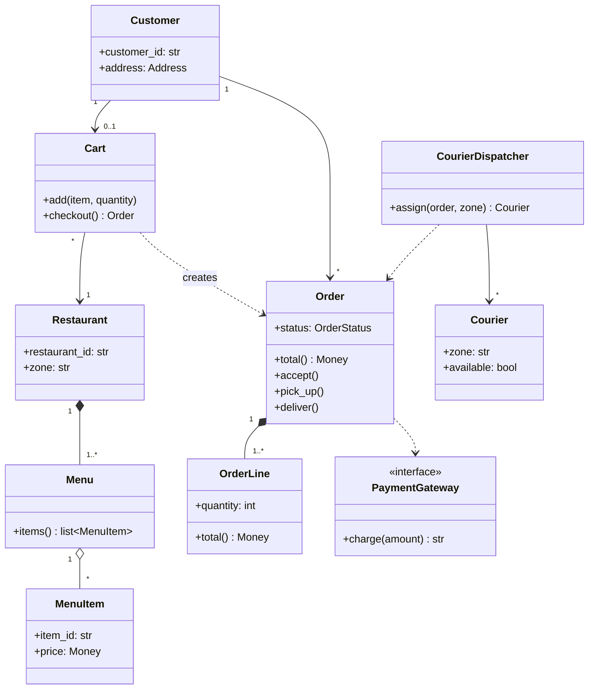

# Object modeling

Object modeling is the step from a list of requirements to a set of classes, each with a clear responsibility. It is the central skill of an LLD round: patterns, principles, and diagrams all assume a reasonable set of objects already exists. A weak model cannot be rescued by good code, while a good model makes the code short.

This note covers noun and verb extraction, CRC cards, assigning responsibilities, the split between entities, value objects, and services, spotting god objects and anemic models early, and naming.

All examples use one domain: a food ordering platform with customers, restaurants, menus, orders, and couriers.

## The requirements used in this note

> Customers browse restaurants and their menus, add menu items to a cart, and place an order from a single restaurant. The order total includes item prices, a delivery fee, and any promo code discount. The customer pays by card when placing the order. The restaurant accepts or rejects the order and prepares the food. The system assigns an available courier in the restaurant's zone, who picks up the order and delivers it to the customer's address. Customers can track the order's status until delivery.

## Noun and verb extraction

The quickest route from requirements to candidate classes: nouns suggest classes and attributes, and verbs suggest responsibilities and methods. The technique produces candidates, not a model. Most of the work is filtering.

### Nouns

Raw nouns from the requirements: customer, restaurant, menu, menu item, cart, order, order total, item price, delivery fee, promo code, discount, card, food, system, courier, zone, address, status, delivery.

Filtering rules, applied in order:

- Merge synonyms: "Food" and "menu item" refer to the same thing here. Keep the one the domain uses consistently: `MenuItem`.
- Demote attributes: "Item price", "delivery fee", and "order total" are amounts belonging to something else. They become fields or computed values, typed as `Money`.
- Demote states: "Status" and "delivery" describe where an order is in its lifecycle. They become an `OrderStatus` enum on `Order`, not classes.
- Move external systems behind interfaces: "Card" payment happens at a provider outside the system, so it becomes a `PaymentGateway` interface, not a `Card` class with charging logic.
- Drop vague and meta nouns: "System" is the thing being designed, not a class inside it. A class called `System` or `App` is where a god object starts.
- Keep what has identity or rules: `Customer`, `Restaurant`, `Menu`, `Cart`, `Order`, `Courier`, and `PromoCode` each have an identity, a lifecycle, or rules to enforce.

Resulting candidates:

- Entities: `Customer`, `Restaurant`, `Menu`, `Cart`, `Order`, `Courier`, `PromoCode`.
- Value objects: `Money`, `Address`, `OrderLine`, `OrderStatus`.
- Interfaces to external systems: `PaymentGateway`.

### Verbs

Verbs from the requirements, each mapped to the class that should own it:

- Browse restaurants and menus: queries on `Restaurant` and `Menu`.
- Add to cart: `Cart.add(item, quantity)`.
- Place an order: `Cart.checkout()` creates an `Order`, since the cart holds the data the order is built from.
- Compute the total: `Order.total()`, since the order holds its lines, fee, and discount.
- Pay: `PaymentGateway.charge(amount)`, called during placement.
- Accept, reject, pick up, deliver: status transitions on `Order`.
- Assign a courier: needs the order and the set of available couriers, which no single entity holds. This is a candidate for a service.
- Track status: a query on `Order`.

The verb pass is where missing classes show up. "Assign a courier" has no natural owner among the entities, which is the signal that a service is needed.

## CRC cards

A CRC card (Class, Responsibilities, Collaborators) lists, for one class, what it knows and does, and which other classes it needs to do that. The format forces each class to be justified by its responsibilities rather than its data, and it is fast to sketch before committing to a diagram.

```plaintext
+--------------------------------------------------------+
| Cart                                                   |
+-------------------------------------+------------------+
| Responsibilities                    | Collaborators    |
+-------------------------------------+------------------+
| Hold items from a single restaurant | MenuItem         |
| Add and remove items                | Restaurant       |
| Create an order at checkout         | Order, OrderLine |
+-------------------------------------+------------------+

+--------------------------------------------------------+
| Order                                                  |
+-------------------------------------+------------------+
| Know its lines, fee, and discount   | OrderLine, Money |
| Compute its total                   | PromoCode        |
| Enforce valid status transitions    | OrderStatus      |
+-------------------------------------+------------------+

+--------------------------------------------------------+
| CourierDispatcher                                      |
+-------------------------------------+------------------+
| Pick an available courier in a zone | Courier          |
| Mark the courier as busy            | Order            |
+-------------------------------------+------------------+
```

Two checks make the cards useful:

- Walk a use case across them, for "place an order" example: `Cart` creates an `Order` from its lines, `Order` computes its total, the total is charged through `PaymentGateway`, and the order is handed to the restaurant. A step with no card to own it is a missing responsibility.
- Look for overloaded cards: A card with more than four or five responsibilities, or with responsibilities that share no data, is a class doing too much and should be split.

## Assigning responsibilities

The question that comes up constantly while modeling is "which class should own this method?". The default answer is the class that holds the data the method needs. This is the Information Expert principle, covered with the rest of GRASP in [note 12](12-grasp-principles.md).

Applied to the food ordering model:

- The order total needs the lines, the delivery fee, and the discount. `Order` holds all three, so `Order.total()` belongs there, not in a `PriceCalculator` that reaches into the order's fields.
- Whether an item can be added needs to know which restaurant the cart already belongs to. `Cart` holds that, so the single-restaurant rule lives in `Cart.add`.
- Creating an `Order` needs the cart's contents. `Cart` holds them, so `Cart.checkout()` creates the order (the Creator principle).
- Courier assignment needs every available courier in a zone. No entity holds that, so the responsibility goes to a service built for it.

When the Information Expert answer puts unrelated concerns into one class, such as persistence or notifications inside `Order`, it gives way to cohesion. Those concerns go to separate classes even though `Order` holds the data ([note 08](08-coupling-and-cohesion.md)).

## Entities, value objects, and services

Every candidate class falls into one of three kinds. The kind decides how it is compared, whether it changes, and where behavior goes.

|  Layer   | Entity                  | Value object       | Service             |
|----------|-------------------------|--------------------|---------------------|
| Identity | Yes                     | No                 | No                  |
| Equality | By ID                   | By value           | n/a                 |
| Mutable  | Yes, over its lifecycle | No                 | Usually stateless   |
| Example  | `Order`, `Courier`      | `Money`, `Address` | `CourierDispatcher` |

### Value objects

A value object is defined entirely by its values. Two `Money(10, "USD")` instances are interchangeable, and a changed amount is a new value, not a modified one. Value objects are immutable, validate themselves on construction, and carry behavior that belongs to the value:

```python
from dataclasses import dataclass
from decimal import Decimal


@dataclass(frozen=True)
class Money:
    amount: Decimal
    currency: str = "USD"

    def __add__(self, other: "Money") -> "Money":
        if other.currency != self.currency:
            raise ValueError(f"cannot add {other.currency} to {self.currency}")
        return Money(self.amount + other.amount, self.currency)

    def __mul__(self, factor: int) -> "Money":
        return Money(self.amount * factor, self.currency)


@dataclass(frozen=True)
class OrderLine:
    item_id: str
    name: str
    unit_price: Money
    quantity: int

    def __post_init__(self) -> None:
        if self.quantity < 1:
            raise ValueError("quantity must be at least 1")

    def total(self) -> Money:
        return self.unit_price * self.quantity
```

Using `Money` instead of a bare `Decimal` puts the currency rule in one place. Primitive obsession (passing amounts, addresses, and IDs around as raw `float`s, `str`s, and `dict`s) is one of the most common modeling weaknesses in interview code, and value objects are the fix.

`OrderLine` copies the item's name and price instead of referencing the `MenuItem`. A menu price change must not alter an order that was already placed, so the line records the price at the time of ordering.

### Entities

An entity has an identity that stays the same while its attributes change. An order that moves from placed to delivered is still the same order. Entities compare by ID, and they own the rules about how they may change:

```python
from decimal import Decimal
from enum import Enum


class OrderStatus(Enum):
    PLACED = "placed"
    ACCEPTED = "accepted"
    PICKED_UP = "picked_up"
    DELIVERED = "delivered"
    REJECTED = "rejected"


class InvalidTransition(Exception):
    pass


class Order:
    _ALLOWED = {
        OrderStatus.PLACED: {OrderStatus.ACCEPTED, OrderStatus.REJECTED},
        OrderStatus.ACCEPTED: {OrderStatus.PICKED_UP},
        OrderStatus.PICKED_UP: {OrderStatus.DELIVERED},
        OrderStatus.DELIVERED: set(),
        OrderStatus.REJECTED: set(),
    }

    def __init__(self, order_id: str, lines: list[OrderLine], delivery_fee: Money) -> None:
        if not lines:
            raise ValueError("an order needs at least one line")
        self.order_id = order_id
        self._lines = tuple(lines)
        self._delivery_fee = delivery_fee
        self._status = OrderStatus.PLACED

    @property
    def status(self) -> OrderStatus:
        return self._status

    def total(self) -> Money:
        zero = Money(Decimal("0"), self._delivery_fee.currency)
        return sum((line.total() for line in self._lines), zero) + self._delivery_fee

    def accept(self) -> None:
        self._move_to(OrderStatus.ACCEPTED)

    def reject(self) -> None:
        self._move_to(OrderStatus.REJECTED)

    def pick_up(self) -> None:
        self._move_to(OrderStatus.PICKED_UP)

    def deliver(self) -> None:
        self._move_to(OrderStatus.DELIVERED)

    def _move_to(self, new_status: OrderStatus) -> None:
        if new_status not in self._ALLOWED[self._status]:
            raise InvalidTransition(f"{self._status.value} -> {new_status.value}")
        self._status = new_status

    def __eq__(self, other: object) -> bool:
        return isinstance(other, Order) and other.order_id == self.order_id

    def __hash__(self) -> int:
        return hash(self.order_id)
```

The transition table is the order's lifecycle written as data. It is what a state diagram of the order shows ([note 07](07-uml-behavioral-diagrams.md)). If each status later needs substantial behavior of its own, the table becomes the State pattern ([behavioral patterns](design-patterns/03-behavioral-patterns.md)). The promo code discount is left out here to keep the example short. It would be one more field that `total()` subtracts.

### Services

A service holds an operation that does not belong to any single entity, usually because it coordinates several of them. Services are named after the operation they perform and hold little or no state of their own:

```python
from dataclasses import dataclass


@dataclass
class Courier:
    courier_id: str
    zone: str
    available: bool = True


class NoCourierAvailable(Exception):
    pass


class CourierDispatcher:
    def __init__(self, couriers: list[Courier]) -> None:
        self._couriers = couriers

    def assign(self, order: Order, zone: str) -> Courier:
        courier = next((c for c in self._couriers if c.available and c.zone == zone), None)
        if courier is None:
            raise NoCourierAvailable(f"no courier in {zone} for order {order.order_id}")
        courier.available = False
        return courier
```

The failure mode is the opposite overuse: moving logic that does belong to an entity into a service because services feel like the place for logic. That leads straight to the anemic model described below. A service is a last resort after checking that no entity is the natural owner. Tactical domain-driven design treats these three kinds in more depth, along with aggregates and repositories ([note 09](09-domain-modeling.md)).

## Spotting god objects early

A god object is a class that knows or does most of the system. It usually starts as the class named after the whole problem:

```python
class FoodDeliveryManager:
    def register_customer(self, name: str, address: str) -> str: ...
    def add_restaurant(self, name: str, zone: str) -> str: ...
    def update_menu(self, restaurant_id: str, items: list[dict]) -> None: ...
    def add_to_cart(self, customer_id: str, item_id: str, quantity: int) -> None: ...
    def place_order(self, customer_id: str, card_number: str) -> str: ...
    def accept_order(self, order_id: str) -> None: ...
    def assign_courier(self, order_id: str) -> str: ...
    def apply_promo(self, order_id: str, code: str) -> None: ...
    def send_status_sms(self, order_id: str) -> None: ...
```

Symptoms that show up early, before any code is written:

- The class is named after the problem or has a vague suffix: `System`, `App`, `Manager`, `Controller`.
- Its methods fall into groups that use disjoint data. Menu methods never touch courier data, and payment methods never touch menus. That is low cohesion ([note 08](08-coupling-and-cohesion.md)).
- Every new requirement edits it.
- The other classes are plain data holders that it reaches into.

The fix is to move each group of methods to the class that owns its data (`Cart.add`, `Order.accept`, `Menu.update`) and to keep, at most, a thin application-level facade that coordinates use cases without holding business rules.

## Spotting anemic models early

An anemic domain model is the mirror image of a god object: entities are pure data, and all behavior lives in services that manipulate them.

```python
from dataclasses import dataclass


@dataclass
class AnemicOrder:
    order_id: str
    lines: list[OrderLine]
    status: str


class OrderService:
    def accept(self, order: AnemicOrder) -> None:
        if order.status != "placed":
            raise InvalidTransition(order.status)
        order.status = "accepted"
```

The rule "only a placed order can be accepted" lives in `OrderService`, but nothing stops other code from writing `order.status = "delivered"` directly. Every rule is one bypass away from being broken, and the same checks end up duplicated wherever orders are touched. The `Order` entity above is the rich version: the status can only change through methods that check the transition table.

Signs of an anemic model: entity classes with only fields and getters, service methods whose first parameter is an entity they mutate, and status fields typed as `str`.

## Naming

Names are the first thing an interviewer reads on the diagram, and vague names usually point at vague responsibilities.

- Name classes with nouns from the domain's own language. If the requirements say "order", the class is `Order`, not `Purchase` in one place and `OrderRecord` in another.
- Avoid suffixes that carry no meaning: `Manager`, `Processor`, `Handler`, `Helper`, `Util`, `Data`, `Info`. Name what the class decides or represents: `CourierDispatcher`, not `CourierManager`.
- Name commands with verbs and queries with nouns or questions: `accept()`, `total()`, `is_open()`. Booleans read as questions: `is_available`, `has_discount`, `can_deliver_to`.
- Name the concept, not the implementation. The domain depends on `PaymentGateway`, and `StripeGateway` is one implementation of it.
- Do not encode types in names. `orders`, not `order_list`, and `total`, not `total_decimal`.
- Keep one name per concept across the whole model, in code, on the diagram, and when speaking.

## The resulting model



Relationship types and multiplicities follow [note 05](05-class-relationships.md). `Order` composes its `OrderLine`s because lines are created with the order and mean nothing without it. `Menu` aggregates `MenuItem`s because one item can appear on several of a restaurant's menus (lunch and dinner) and exists independently of any one of them.
