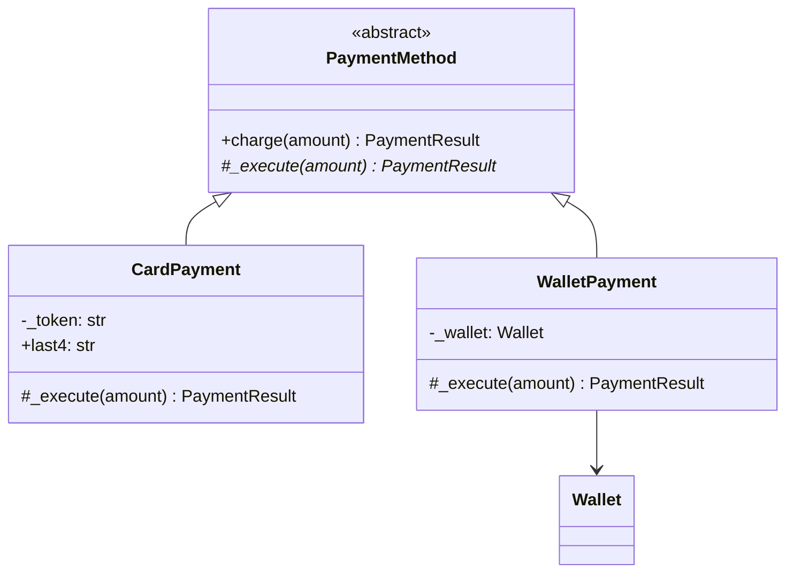

# OOP core concepts

Encapsulation, abstraction, inheritance, and polymorphism are the vocabulary every design decision in an LLD round is justified with. Interviewers rarely ask for them to be defined in isolation. They ask why a field is private, why this is an interface and not a base class, or what happens when a method is called through a parent reference.

This note states each concept, then covers the mechanics interviewers probe: static versus dynamic dispatch, interface versus abstract class, overriding versus overloading, and access modifiers. Python differs from the Java/C++ model most LLD material assumes, and those differences are covered where they come up.

All examples use one domain: a checkout that accepts several payment methods (cards, wallets, bank transfers).

## The four concepts at a glance

- Encapsulation: an object's state changes only through operations that keep its rules or conditions true. The benefit is that these rules are enforced in one place. In this domain, a `Wallet` balance can only change through `deposit` and `withdraw`, which refuse to let it go negative.
- Abstraction: clients depend on what an operation does, not on how it is done, so callers are insulated from implementation changes. `Checkout` calls `charge(amount)` without knowing whether a card network or a wallet is behind it.
- Inheritance: a class is defined as an extension of another and inherits its interface and, optionally, its implementation. It provides subtyping plus some code reuse e.g. `CardPayment` is a `PaymentMethod`.
- Polymorphism: one call site works with values of many types, and the behavior is chosen per type. New types can be added without editing callers. `method.charge(amount)` runs card, wallet, or transfer logic depending on the object.

The pair interviewers most often ask to distinguish is encapsulation and abstraction. Abstraction is a design-level choice about what a client gets to see: the contract. Encapsulation is the mechanism that protects an object's internals so that contract holds. An interface is abstraction without encapsulation, since it has no state. A class with private fields and no meaningful interface is encapsulation with poor abstraction.

## Encapsulation

Encapsulation means keeping data together with the operations that are allowed to change it, so the object can guarantee its own rules. Hiding fields is the means, not the goal.

The common misconception is that encapsulation means "make fields private and add getters and setters". A setter for every field hides nothing. It just moves the rule checks into every caller:

```python
from decimal import Decimal


class LeakyWallet:
    def __init__(self, balance: Decimal) -> None:
        self._balance = balance

    def get_balance(self) -> Decimal:
        return self._balance

    def set_balance(self, value: Decimal) -> None:
        self._balance = value


# Every caller now owns the "no negative balance" rule — and one of them will forget it.
wallet = LeakyWallet(Decimal("50"))
wallet.set_balance(wallet.get_balance() - Decimal("80"))  # balance is now -30
```

The encapsulated version exposes intent-revealing operations and rejects any change that would break the rule:

```python
from decimal import Decimal


class InsufficientFunds(Exception):
    pass


class Wallet:
    def __init__(self, owner_id: str, balance: Decimal = Decimal("0")) -> None:
        if balance < 0:
            raise ValueError("opening balance cannot be negative")
        self._owner_id = owner_id
        self._balance = balance

    @property
    def balance(self) -> Decimal:
        return self._balance

    def deposit(self, amount: Decimal) -> None:
        self._require_positive(amount)
        self._balance += amount

    def withdraw(self, amount: Decimal) -> None:
        self._require_positive(amount)
        if amount > self._balance:
            raise InsufficientFunds(f"balance {self._balance} < {amount}")
        self._balance -= amount

    @staticmethod
    def _require_positive(amount: Decimal) -> None:
        if amount <= 0:
            raise ValueError("amount must be positive")
```

Why this design holds up:

- The rule (balance ≥ 0) lives in exactly one class. No caller can break it, and a reviewer only has to check one place.
- `balance` is readable but not assignable. Reads are safe to expose. Unrestricted writes are not.
- The operations use domain verbs (`withdraw`), not data verbs (`set_balance`). That is the step from a data holder to an object that owns behavior, and the same instinct as the Tell, Don't Ask heuristic in [note 10](10-general-design-heuristics.md).
- Encapsulation is also what makes thread-safety possible later. If every mutation goes through `withdraw`, one lock inside `Wallet` covers them all ([note 13](13-concurrency.md)). If callers write the field directly, no single place can hold that lock.

Common follow-up: "Is returning a mutable collection from a getter a problem?" Yes. If `Wallet` kept a `list` of transactions and returned it directly, callers could append to it without going through the rules. Return a tuple, a copy, or a read-only view.

## Abstraction

Abstraction means modeling something by what it does and leaving out how it does it, so clients depend only on the contract. In a design round it shows up as the interfaces (abstract types) placed between collaborators.

```python
from abc import ABC, abstractmethod
from dataclasses import dataclass
from decimal import Decimal


@dataclass(frozen=True)
class PaymentResult:
    succeeded: bool
    reference: str | None = None
    failure_reason: str | None = None


class PaymentMethod(ABC):
    @abstractmethod
    def charge(self, amount: Decimal) -> PaymentResult:
        """Attempt to take `amount` from this payment method."""


class Checkout:
    def pay(self, total: Decimal, method: PaymentMethod) -> PaymentResult:
        # Checkout knows nothing about card networks, wallets, or bank APIs.
        return method.charge(total)
```

A good abstraction has three properties:

1. It is written in the client's terms. `charge(amount)` is what the checkout needs. `send_iso8583_message(...)` exposes the card implementation and does not work for a wallet.
2. It is as small as the clients need. If only some methods can be refunded, putting `refund()` on `PaymentMethod` forces bank transfers to implement something they cannot do. That is the interface segregation principle ([note 11](11-solid-principles.md)).
3. It is stable. The point of the abstraction is that `Checkout` does not change when a payment method is added, so its signature should not have to change either.

The trap is abstracting too early. Putting an interface in front of something that has one implementation and no expected variation adds indirection and gives nothing back. Introduce an abstraction when the requirements name a real axis of variation ("we support cards and wallets, more later"), and cite that axis as the justification.

## Inheritance

Inheritance defines a class as an extension of another. It provides two separate things:

- Interface inheritance (subtyping). A `CardPayment` can be used anywhere a `PaymentMethod` is expected. This is the part that enables polymorphism.
- Implementation inheritance (code reuse). `CardPayment` also gets whatever concrete code `PaymentMethod` defines.

Here the base class carries shared behavior (validation) and subclasses supply only the part that differs:

```python
from abc import ABC, abstractmethod
from decimal import Decimal


class PaymentMethod(ABC):
    def charge(self, amount: Decimal) -> PaymentResult:
        if amount <= 0:
            return PaymentResult(succeeded=False, failure_reason="non-positive amount")
        return self._execute(amount)

    @abstractmethod
    def _execute(self, amount: Decimal) -> PaymentResult: ...


class CardPayment(PaymentMethod):
    def __init__(self, token: str, last4: str) -> None:
        self._token = token
        self.last4 = last4

    def _execute(self, amount: Decimal) -> PaymentResult:
        # Call the card processor with self._token ...
        return PaymentResult(succeeded=True, reference=f"card-{self.last4}")


class WalletPayment(PaymentMethod):
    def __init__(self, wallet: Wallet) -> None:
        self._wallet = wallet

    def _execute(self, amount: Decimal) -> PaymentResult:
        try:
            self._wallet.withdraw(amount)
        except InsufficientFunds as exc:
            return PaymentResult(succeeded=False, failure_reason=str(exc))
        return PaymentResult(succeeded=True, reference="wallet")
```



The public `charge` fixes the algorithm and the protected `_execute` is the hook subclasses fill in. That is the Template Method pattern ([behavioral patterns](design-patterns/03-behavioral-patterns.md)). It is the case where implementation inheritance works well: a small, stable skeleton with one well-defined extension point.

Points commonly probed:

- "Is-a" is necessary but not sufficient. The real test is substitutability. Every subclass must honor the base class contract, so a subclass whose `charge` raises `NotImplementedError` for some amounts breaks callers written against `PaymentMethod`. This is the Liskov substitution principle, covered in [note 11](11-solid-principles.md).
- Inheritance used only for reuse is the classic mistake. If `CardPayment` extended an `HttpClient` to get its `post` method, it would take on every public method of `HttpClient` as part of its own interface. Reuse through a field instead. The full trade-off is in [note 05](05-class-relationships.md#composition-over-inheritance).
- Inheritance is fixed at construction. An object cannot change its class at runtime. If a concept can change category during its lifetime (a customer upgraded to a premium tier), model the category as a component, not as a subclass.

### Python specifics: `super()`, MRO, and multiple inheritance

Python allows multiple inheritance and resolves method lookup with the method resolution order (MRO), a C3 linearization of the class hierarchy, inspectable with `Class.__mro__`. `super()` does not mean "my parent". It means "the next class in the MRO of the actual object", which is what lets cooperative mixins chain calls:

```python
class AuditedMixin:
    def charge(self, amount: Decimal) -> PaymentResult:
        result = super().charge(amount)
        print(f"audit: {type(self).__name__} charged {amount}: {result.succeeded}")
        return result


class AuditedCardPayment(AuditedMixin, CardPayment):
    pass


# MRO: AuditedCardPayment → AuditedMixin → CardPayment → PaymentMethod → ABC → object
```

Diamond problem: in Python the MRO linearizes the diamond, so each class appears once and `super()` visits each exactly once. Java avoids the problem by allowing only single class inheritance.

## Polymorphism

Polymorphism means one piece of code working with values of different types, with the behavior chosen according to each value's type. There are three kinds:

- Subtype (inclusion) polymorphism: an object of a subclass is used through its base type, and the override to run is picked at runtime. Python gets it through method overriding and duck typing. Java gets it through overriding and interfaces.
- Ad hoc polymorphism: different implementations for different argument types under one name. In Python that means `functools.singledispatch` and operator dunders such as `__add__`. In Java it means method overloading.
- Parametric polymorphism: code written once that works for any type. Both languages call this generics. In Python, generics (`list[T]`, `TypeVar`) are checked by the type checker and have no effect at runtime.

In LLD, "polymorphism" almost always means subtype polymorphism. Its practical value is removing type-switching conditionals from client code:

```python
# Without polymorphism: every new payment method edits this function.
def pay(total: Decimal, kind: str, details: dict[str, str]) -> PaymentResult:
    if kind == "card":
        ...
    elif kind == "wallet":
        ...
    elif kind == "bank_transfer":
        ...
    raise ValueError(f"unknown payment kind: {kind}")


# With polymorphism: Checkout.pay (from the abstraction section) never changes.
# Adding BankTransferPayment is a new class, not an edit.
```

This answers the "now add Apple Pay" follow-up: the change is a new class, and nothing that already works is touched. That is the open/closed principle in practice ([note 11](11-solid-principles.md)). A type-switch that shows up in several places is a strong sign that a polymorphic abstraction is missing.

### Duck typing

Python does not require a shared base class for polymorphism. Any object with a compatible `charge` method works at runtime ("if it walks like a duck"). `typing.Protocol` makes that implicit contract visible to type checkers without forcing inheritance. See [interface versus abstract class](#interface-versus-abstract-class) below.

## Static versus dynamic dispatch

Dispatch is how a call site gets bound to the code that runs.

- Static (early) dispatch: the target is chosen at compile time from the declared types. Examples: Java overload resolution, `static`/`private`/`final` methods, C++ non-virtual methods.
- Dynamic (late) dispatch: the target is chosen at runtime from the actual type of the receiver. Examples: Java instance method overriding, C++ `virtual` methods.

The classic trap needs a statically typed language to show, so this snippet is Java. The difference does not exist in Python.

```java
class ReceiptPrinter {
    String render(PaymentMethod m) { return "Paid"; }
    String render(CardPayment c)   { return "Paid by card ending " + c.last4(); }
}

PaymentMethod m = new CardPayment("tok_123", "4242");

printer.render(m);   // "Paid" — the overload is picked from the STATIC type (PaymentMethod)
m.charge(amount);    // CardPayment's charge — the override is picked from the RUNTIME type
```

How the snippet resolves:

- Overloading: methods share a name but differ in parameter types or count. Java picks the overload at compile time from the declared argument types (static dispatch). `m` is declared as `PaymentMethod`, so `render(PaymentMethod)` runs even though `m` holds a `CardPayment` at runtime.
- Overriding: a subclass replaces a superclass method. Java picks the override at runtime from the object's actual type (dynamic dispatch), so `m.charge(amount)` runs `CardPayment`'s version.
- Single dispatch: Java considers only the runtime type of the receiver (the object before the dot). Argument types matter only at compile time, for choosing an overload.
- Double dispatch: choosing behavior from the runtime types of two objects is not supported directly. The Visitor pattern emulates it.

In short, overloading is compile-time selection on argument types, and overriding is runtime selection on the receiver's type.

Python has no compile-time binding. Every `obj.method()` is an attribute lookup at runtime along `type(obj).__mro__`, so every method call is dynamically dispatched. Choosing behavior by an argument's runtime type has to be requested explicitly, with `functools.singledispatchmethod`:

```python
from functools import singledispatchmethod


class ReceiptPrinter:
    @singledispatchmethod
    def render(self, method: PaymentMethod) -> str:
        return "Paid"

    @render.register
    def _(self, method: CardPayment) -> str:
        return f"Paid by card ending {method.last4}"


ReceiptPrinter().render(CardPayment("tok_123", "4242"))  # "Paid by card ending 4242"
```

Unlike Java's overloading, this dispatches on the runtime type, so the trap above does not apply.

## Interface versus abstract class

The differences that matter for design:

- What it expresses. An interface describes a capability or role, such as "can be refunded". An abstract class is a partial implementation of a family, such as "is a payment method".
- Coupling. Implementers of an interface depend only on its method signatures. Subclasses of an abstract class also depend on its internals: the fields it holds and the order in which its concrete methods call the abstract ones.
- When to choose which. Use an interface when unrelated classes share a capability or when the thinnest possible contract is wanted. Use an abstract class when related classes share real code and a common skeleton.

In one line: an interface defines what a role can do. An abstract class also provides part of how, for classes that are variations of one thing. Start with an interface. Introduce an abstract class once real shared implementation appears, not in anticipation of it.

### In Python: `abc.ABC` versus `typing.Protocol`

Python has no `interface` keyword. It has two tools, and they differ in how conformance is decided:

- `abc.ABC` is nominal. A class conforms only if it inherits from the ABC (or is registered with it). Instantiating a subclass that leaves an `@abstractmethod` unimplemented raises `TypeError` at runtime. ABCs can carry concrete methods and state, so they fill the abstract-class role.
- `typing.Protocol` is structural. Any class whose methods match conforms, with no inheritance needed. Type checkers such as mypy and pyright verify it statically, and `@runtime_checkable` enables `isinstance` checks, though those only confirm that the methods exist, not their signatures. Protocols fill the interface role.

```python
from typing import Protocol


class Refundable(Protocol):
    def refund(self, reference: str, amount: Decimal) -> PaymentResult: ...


class CardPayment(PaymentMethod):  # nominal: is a PaymentMethod
    ...
    def refund(self, reference: str, amount: Decimal) -> PaymentResult:
        ...                           # structural: satisfies Refundable, no inheritance


def issue_refund(target: Refundable, reference: str, amount: Decimal) -> PaymentResult:
    return target.refund(reference, amount)
```

`PaymentMethod` is an ABC because payment methods share a skeleton (`charge` validating before calling `_execute`). `Refundable` is a protocol because refundability is a capability that some payment methods have and others, such as a cash voucher, do not. Protocols also work for classes outside the codebase's control, such as a third-party SDK client, which cannot be given a new base class. This choice comes up again with dependency inversion in [note 11](11-solid-principles.md).

## Overriding versus overloading

- Overriding: a subclass redefines an inherited method with the same signature. It works across a class hierarchy, is resolved at runtime by the receiver's type, and is a form of subtype polymorphism. In Java the override must keep the same parameters. It may narrow the return type (a covariant return), but it cannot reduce visibility or throw broader checked exceptions.
- Overloading: several methods in one class (or scope) share a name but take different parameters. It is resolved at compile time from the argument types and is a form of ad hoc polymorphism. In Java the overloads must differ in parameter types or count. A different return type alone is not enough.

Overriding is also constrained by the base contract. An override may accept more and promise more, but it must not demand more or deliver less. That is Liskov again.

Python has no overloading. A second `def` with the same name simply replaces the first:

```python
class Receipts:
    def render(self, method: CardPayment) -> str:
        return "card"

    def render(self, method: WalletPayment) -> str:  # replaces the method above
        return "wallet"
```

The Pythonic substitutes, in order of preference:

1. Default and keyword arguments, for "the same operation with optional extras".
2. `functools.singledispatch` / `singledispatchmethod`, for different behavior per argument type.
3. `typing.overload`, which declares multiple signatures for the type checker only. There is still one implementation, which branches internally.

Asked how to overload in Python: the language does not support it, so name the substitute that fits.

## Access modifiers

| Modifier        | Java        | C++          | Python convention       |
|-----------------|-------------|--------------|-------------------------|
| Public          | `public`    | `public:`    | `name`                  |
| Protected       | `protected` | `protected:` | `_name`                 |
| Package-private | (default)   | n/a          | `_name` at module level |
| Private         | `private`   | `private:`   | `__name`                |

Java's `protected` is also visible to the whole package, not only to subclasses. Python's single underscore means "internal, though subclasses may use it", and the double underscore triggers name mangling.

Python enforces none of this. `_balance` is a convention that linters and IDEs respect, and `__token` is rewritten to `_CardPayment__token`:

```python
class CardPayment(PaymentMethod):
    def __init__(self, token: str, last4: str) -> None:
        self.__token = token  # stored as self._CardPayment__token
        self.last4 = last4

    def _execute(self, amount: Decimal) -> PaymentResult:
        return PaymentResult(succeeded=True, reference=f"card-{self.last4}")


card = CardPayment("tok_123", "4242")
card._CardPayment__token  # still reachable
```

Name mangling exists to prevent accidental attribute clashes between a class and its subclasses. It is not a privacy mechanism. The practical rule is to use a single underscore for anything that is not part of the public interface and to reserve the double underscore for the rare case where a subclass might realistically reuse the name.

Python can still encapsulate without real access modifiers. Encapsulation is about the interface a class offers and the rules it keeps, and the underscore marks the boundary. Java's `private` can be bypassed through reflection too. Access control in any language guards against mistakes, not against someone determined to get around it. What protects a rule is that there is no public way to break it, as with `Wallet` having no `set_balance`.

Choosing visibility in a design: start with everything private and widen access only when a real client needs it. Protected members are part of the class's contract with subclasses, which makes them harder to change than they look.

## Quick-fire questions

Rapid-fire checks that come up mid-design, each with a one- or two-sentence answer.

- Encapsulation versus abstraction? Abstraction chooses what a client sees (the contract). Encapsulation protects internal state so that contract and its rules hold.
- Are getters and setters encapsulation? Not by themselves. A public setter with no rules is a public field with extra syntax. Encapsulation means state changes only through operations that preserve rules.
- Interface or abstract class? An interface for a capability or thin contract. An abstract class when related types share real implementation. Default to the interface.
- Overloading versus overriding? Overloading is the same name with different parameters, resolved at compile time by argument types. Overriding is a subclass redefining a method, resolved at runtime by the receiver's type.
- Does Python have overloading? No. The last `def` wins. Use default arguments, `singledispatch`, or `typing.overload` (type checker only).
- Does Python have interfaces? Not as a keyword. Use `typing.Protocol` for structural interfaces and `abc.ABC` for nominal, partially implemented ones.
- What is dynamic dispatch? Choosing the method implementation from the receiver's runtime type. In Python every method call works this way.
- When is inheritance the wrong tool? When the relationship is not substitutable, when the goal is only code reuse, or when an object's category can change at runtime. See [note 05](05-class-relationships.md).
