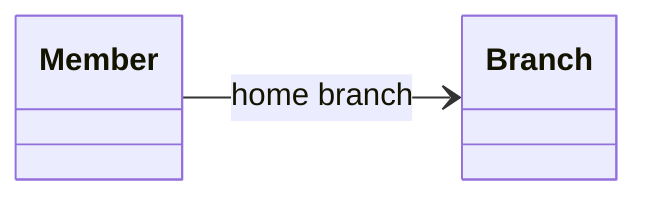
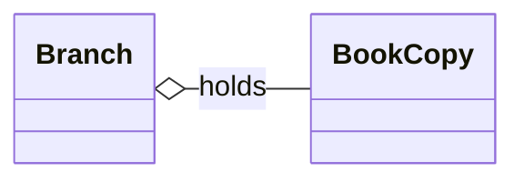
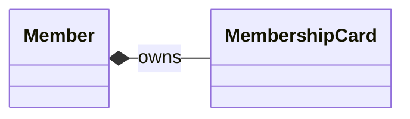
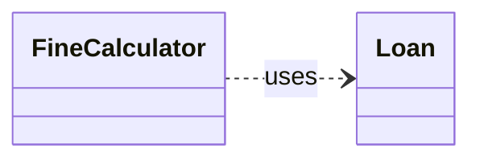
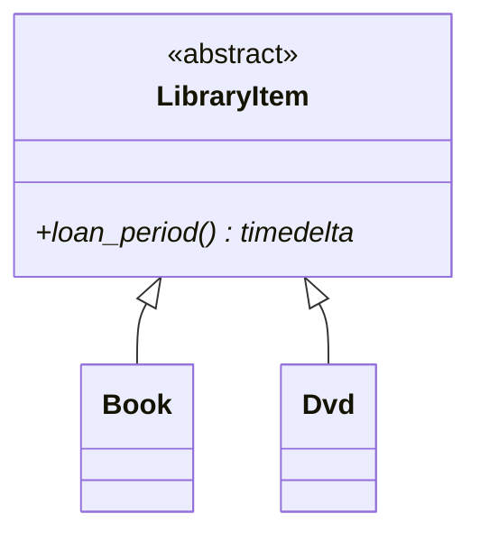
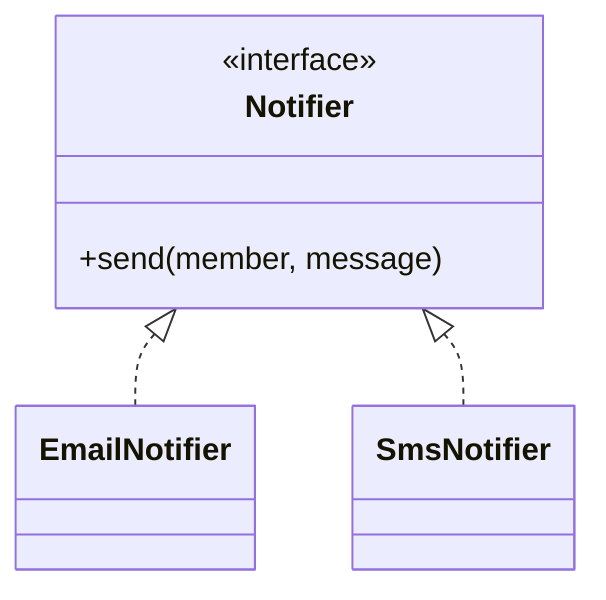
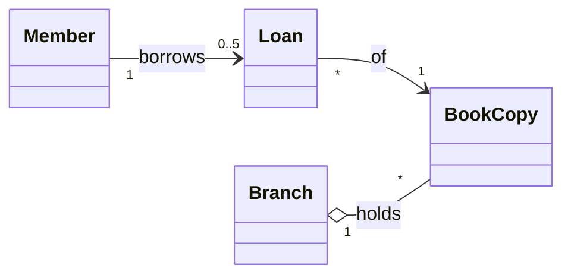
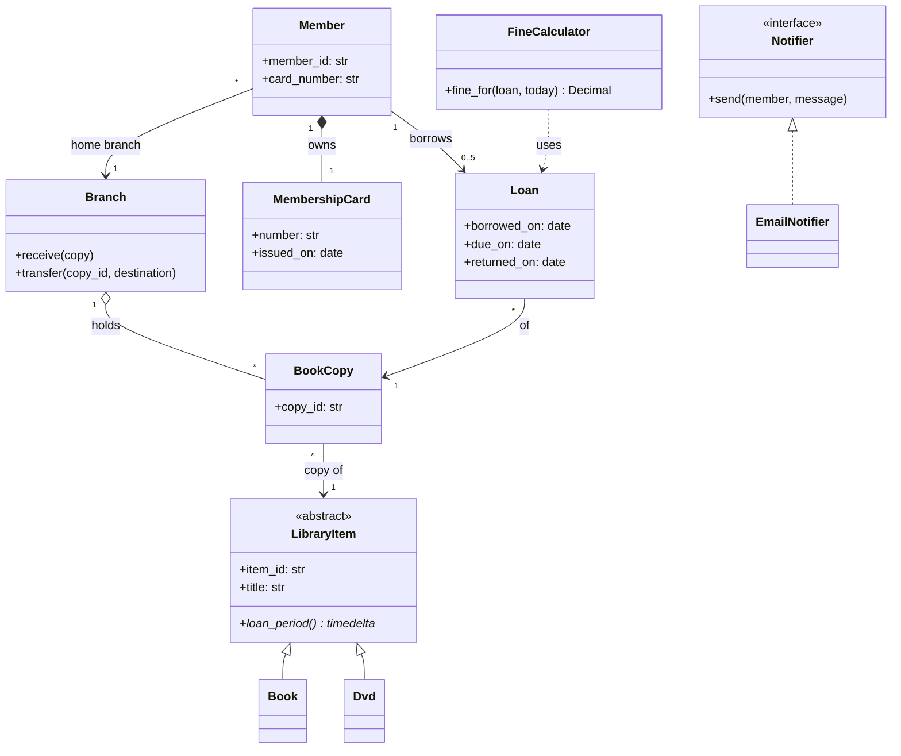

# Class relationships

Once there is a set of classes, the next question is how they connect. Each relationship type answers two questions: how long does the other object live, and who is responsible for it. With the right relationships, a class diagram shows how the system behaves when objects are created, shared, and destroyed, not just which boxes connect.

This note covers the six relationships (association, aggregation, composition, dependency, generalization, and realization), multiplicity, and the composition versus inheritance decision. Notation is introduced as needed here.

All examples use one domain: a library system with branches, members, books, physical copies, and loans.

## The relationships at a glance

Ordered from weakest to strongest coupling:

- Dependency ("uses, briefly"): no lasting link. The other object is only needed during a call. It appears as a method parameter, a local variable, or a return type.
- Association ("knows about"): the two objects have independent lifetimes and neither owns the other. It appears as an attribute holding a reference that was passed in from outside.
- Aggregation ("has, as a collection of independent parts"): the parts outlive the whole and can move between wholes. It appears as a collection attribute of objects created elsewhere.
- Composition ("is made of"): the whole creates, owns, and ends its parts, and each part belongs to one whole. It appears as an attribute the whole constructs itself and does not hand out.
- Realization ("implements the contract of"): a type relationship. A class implements an ABC's abstract methods or satisfies a `Protocol`.
- Generalization ("is a kind of"): a type relationship. This is subclassing via inheritance.

In UML, each is drawn with its own combination of line style and end marker:

| Relationship   | Line   | End marker                        | Sketch                          |
| -------------- | ------ | --------------------------------- | ------------------------------- |
| Dependency     | Dashed | Open arrowhead at the used class  | `Client - - - -> Supplier`      |
| Association    | Solid  | Open arrowhead (navigability)     | `Member ───────> Branch`        |
| Aggregation    | Solid  | Hollow diamond at the whole       | `Branch ◇─────── BookCopy`      |
| Composition    | Solid  | Filled diamond at the whole       | `Member ◆─────── Card`          |
| Realization    | Dashed | Hollow triangle at the interface  | `EmailNotifier - - -▷ Notifier` |
| Generalization | Solid  | Hollow triangle at the superclass | `Book ───────▷ LibraryItem`     |

Two rules make the notation easy to recall. A dashed line means a weaker or contract-only link (dependency, realization), and a solid line means a structural one. A hollow marker is the weaker form of a filled one: aggregation is the weak version of composition.

The first four describe links between objects at runtime. The last two describe relationships between types. In code the first four can look almost the same, since each is an attribute holding a reference. What distinguishes them is who creates the referenced object, whether it is shared, and what happens to it when the holder goes away.

## Association

An association is a lasting structural link: one object holds a reference to another and uses it over time, but neither owns the other. Both have their own lifecycle.

A member has a home branch. The branch exists before the member joins and keeps existing after the member leaves. The member simply knows about it:

```python
class Branch:
    def __init__(self, branch_id: str, name: str) -> None:
        self.branch_id = branch_id
        self.name = name


class Member:
    def __init__(self, member_id: str, name: str, home_branch: Branch) -> None:
        self.member_id = member_id
        self.name = name
        self.home_branch = home_branch  # passed in; Member did not create it
```



### Navigability and the bidirectional trap

The arrowhead shows navigability: `Member` can reach `Branch`, but not the other way round. Making every association bidirectional ("a branch should also know its members") has a cost: each bidirectional link is two references that must be kept in sync. If code updates one side and not the other, the model becomes inconsistent in a way that is hard to notice.

Make an association bidirectional only when a use case needs to navigate both ways. When it is, give one side the job of maintaining both ends:

```python
class Branch:
    def __init__(self, branch_id: str, name: str) -> None:
        self.branch_id = branch_id
        self.name = name
        self._members: set[Member] = set()

    def enroll(self, member: Member) -> None:
        # The only way to change the link, so both sides always agree.
        if member.home_branch is not self:
            member.home_branch._members.discard(member)
            member.home_branch = self
        self._members.add(member)
```

### Associations that carry data

Some links have attributes of their own. A loan connects a member to a copy and has a due date and a return date. Those belong to neither the member nor the copy, but to the link itself. UML calls this an association class. In code it becomes a first-class object:

```python
from dataclasses import dataclass
from datetime import date


@dataclass
class Loan:
    member: Member
    copy: BookCopy
    borrowed_on: date
    due_on: date
    returned_on: date | None = None
```

Recognizing that a link carries data, and promoting it to a class, is one of the most useful modeling moves in LLD. `Loan`, `Booking`, `Enrollment`, and `Reservation` all come from it.

## Aggregation

Aggregation is a whole–part association in which the parts have independent lifetimes. The whole groups them, but it did not create them, does not own them exclusively, and does not destroy them.

A branch holds physical book copies. Copies can be transferred between branches, and if a branch closes its copies are redistributed, not destroyed:

```python
from dataclasses import dataclass


@dataclass
class BookCopy:
    copy_id: str
    isbn: str


class Branch:
    def __init__(self, branch_id: str, name: str) -> None:
        self.branch_id = branch_id
        self.name = name
        self._copies: dict[str, BookCopy] = {}

    def receive(self, copy: BookCopy) -> None:
        self._copies[copy.copy_id] = copy  # created elsewhere, handed in

    def transfer(self, copy_id: str, destination: "Branch") -> None:
        copy = self._copies.pop(copy_id)
        destination.receive(copy)  # same object, new whole
```



The hollow diamond sits on the whole (`Branch`).

## Composition

Composition is a whole–part relationship with ownership. The whole creates the part, the part belongs to exactly one whole at a time, and the part's lifetime ends with the whole. Nothing outside the whole should hold on to the part independently.

Each member has a membership card. The card is issued when the member is registered, is meaningless without that member, and is cancelled when the membership ends. It is never transferred to another member:

```python
from dataclasses import dataclass
from datetime import date


@dataclass(frozen=True)
class MembershipCard:
    number: str
    issued_on: date


class Member:
    def __init__(self, member_id: str, name: str, home_branch: Branch) -> None:
        self.member_id = member_id
        self.name = name
        self.home_branch = home_branch
        # Created by the whole, from the whole's own data.
        self._card = MembershipCard(number=f"LIB-{member_id}", issued_on=date.today())

    @property
    def card_number(self) -> str:
        return self._card.number  # expose data from the part, not the part itself
```



The filled diamond sits on the whole (`Member`).

Composition is also how a whole protects invariants that span its parts. Suppose a `Member` owned a list of `Reservation` objects and allowed at most three. That limit can only be enforced if every change to the list goes through `Member`. If callers can get the list and append to it, the composition exists only on the diagram. This is the idea behind aggregates in domain-driven design, covered in [note 09](09-domain-modeling.md).

## Aggregation versus composition in practice

In Python (and Java) both are just a field holding a reference, so the difference cannot be seen in the field declaration. It shows up in behavior:

| Question                         | Aggregation  | Composition |
|----------------------------------|--------------|-------------|
| Who creates the part?            | Someone else | The whole   |
| Can the part be shared or moved? | Yes          | No          |
| Does the part outlive the whole? | Yes          | No          |
| Does the whole expose the part?  | Often        | Rarely      |

In code, the composing whole usually creates the part in its constructor or a factory method. It exposes operations on the part, or copies of its data, rather than the mutable part itself. In Python, "the part goes when the whole goes" means that once the whole is gone, nothing else references the part, so it is garbage-collected.

A practical test is to delete the whole and ask whether the part still means something. Deleting a branch leaves its book copies meaningful: they move elsewhere, so that is aggregation. Deleting a member leaves a membership card that means nothing, so that is composition.

## Dependency

A dependency is the weakest relationship. One class uses another briefly, as a method parameter, a local variable, or a return type, and does not keep a reference. A change to the used class's interface may still break the user, which is why the relationship is drawn at all.

Fine calculation uses a loan and a date during one call and keeps neither:

```python
from datetime import date
from decimal import Decimal


class FineCalculator:
    DAILY_RATE = Decimal("0.25")

    def fine_for(self, loan: Loan, today: date) -> Decimal:
        end = loan.returned_on or today
        days_late = (end - loan.due_on).days
        return self.DAILY_RATE * max(days_late, 0)
```



The difference from association is whether the reference is stored. If `FineCalculator` kept `self._loan`, it would be an association, and a strange one, because a calculator should not be tied to a single loan.

Dependency is the relationship to aim for where possible. An object that receives what it needs per call is easier to test and reuse than one that holds long-lived references. Dependency injection ([note 11](11-solid-principles.md)) keeps the dependency on an abstraction and has the caller supply the implementation.

## Generalization

Generalization is the name for inheritance: a subtype is a specialized kind of a supertype, inherits its interface, and can be used wherever the supertype is expected.

The library lends several kinds of items, and each has its own loan period:

```python
from abc import ABC, abstractmethod
from datetime import timedelta


class LibraryItem(ABC):
    def __init__(self, item_id: str, title: str) -> None:
        self.item_id = item_id
        self.title = title

    @abstractmethod
    def loan_period(self) -> timedelta: ...


class Book(LibraryItem):
    def loan_period(self) -> timedelta:
        return timedelta(weeks=3)


class Dvd(LibraryItem):
    def loan_period(self) -> timedelta:
        return timedelta(weeks=1)
```



The hollow triangle points at the supertype.

The trap is a subtype that cannot keep the supertype's promises. A reference book can never leave the library. Modeling it as `class ReferenceBook(Book)` whose checkout raises an error breaks every piece of code that assumes any `Book` can be lent. That is a Liskov violation ([note 11](11-solid-principles.md)). The fix is to model lendability as its own concept, such as a `Lendable` capability or a circulation policy on the item. Do not inherit a promise and then refuse to keep it.

## Realization

Realization is the relationship between a contract and a class that fulfills it. The interface defines only the obligations, and the realizing class supplies all of the behavior. The class inherits no implementation.

Overdue notices go through several channels:

```python
from typing import Protocol


class Notifier(Protocol):
    def send(self, member: Member, message: str) -> None: ...


class EmailNotifier:
    def send(self, member: Member, message: str) -> None:
        ...  # send via SMTP


class SmsNotifier:
    def send(self, member: Member, message: str) -> None:
        ...  # send via SMS gateway
```



The dashed line with a hollow triangle points at the interface.

With `typing.Protocol`, `EmailNotifier` does not even name `Notifier`. It realizes it structurally. The diagram still shows the relationship, because the design depends on it whether or not the code spells it out. Generalization versus realization is the class diagram form of the abstract class versus interface choice from [note 04](04-oop-core-concepts.md#interface-versus-abstract-class).

## Multiplicity

Multiplicity states how many instances take part at each end of an association:

| Notation      | Meaning         | Code shape                            |
|---------------|-----------------|---------------------------------------|
| `1`           | Exactly one     | A required attribute                  |
| `0..1`        | Zero or one     | `X \| None`                           |
| `*` or `0..*` | Any number      | `list`, `set`, or `dict`              |
| `1..*`        | At least one    | Collection, checked non-empty         |
| `0..5`        | A bounded range | Collection, checked against the bound |



Multiplicity is worth writing on the diagram because it shapes the code:

- It chooses the data structure. `0..1` is an optional field and `*` is a collection. A collection that is looked up by key (copies by `copy_id`) should be a `dict`, not a `list`.
- Bounds are invariants. A member may hold at most five loans, so some class has to enforce that: every upper bound on the diagram is a rule in code. Which class owns the check is a responsibility-assignment question ([note 12](12-grasp-principles.md)).
- A lower bound of `1` limits construction. If every `Loan` needs exactly one `BookCopy`, the copy belongs in the constructor, and a `Loan` without one should be impossible to create.
- Upper bounds invite concurrency questions. "At most five loans" and "one active loan per copy" are check-then-act rules, which are exactly what the double-booking follow-up targets ([note 13](13-concurrency.md)).

Say multiplicities out loud while drawing ("a copy is on at most one active loan").

## The library model as a whole

Every relationship type in one diagram:



Key decisions in this model:

- `BookCopy` and `LibraryItem` are separate classes. The item is the title-level record (one per ISBN). The copy is the physical object that gets lent. Merging them makes "how many copies of *Dune* are available?" awkward to answer and is a common modeling mistake.
- `Member → Loan` is an association, not a composition. Loans outlive the member's active borrowing (they stay in history for fines and audits), and loans are also reached from the copy side. Neither end owns them exclusively.
- `FineCalculator` depends on `Loan` but is not associated with it. That keeps it stateless and trivially testable.

## Composition over inheritance

"Favor composition over inheritance" (GoF) means: when a class needs behavior that varies, give it a component that supplies the behavior instead of making it a subclass that overrides it.

### The problem inheritance runs into

Borrowing rules differ by member type. Students may hold 5 items for 3 weeks, and faculty may hold 20 items for a semester. The inheritance version seems natural:

```python
class Member:
    def max_loans(self) -> int:
        return 3

    def loan_period(self) -> timedelta:
        return timedelta(weeks=2)


class StudentMember(Member):
    def max_loans(self) -> int:
        return 5

    def loan_period(self) -> timedelta:
        return timedelta(weeks=3)


class FacultyMember(Member):
    def max_loans(self) -> int:
        return 20

    def loan_period(self) -> timedelta:
        return timedelta(weeks=16)
```

Then the requirements change, and each change is harder to handle than the last:

1. A student graduates and becomes staff. An object cannot change its class, so the fix is to create a new `FacultyMember`, copy every field, and re-point every loan and reservation that referenced the old object. Identity is lost.
2. A paid premium tier is added on top of either type. Now `PremiumStudentMember` and `PremiumFacultyMember` are needed. Each new independent dimension multiplies the number of classes.
3. Rules become configurable per branch. Rules defined in class bodies cannot be loaded from configuration.

### The composed version

Pull the varying behavior into its own abstraction and give the member one:

```python
from dataclasses import dataclass
from datetime import timedelta
from typing import Protocol


class BorrowingPolicy(Protocol):
    def max_loans(self) -> int: ...
    def loan_period(self) -> timedelta: ...


@dataclass(frozen=True)
class StandardPolicy:
    loans: int
    period: timedelta

    def max_loans(self) -> int:
        return self.loans

    def loan_period(self) -> timedelta:
        return self.period


@dataclass(frozen=True)
class PremiumPolicy:
    base: BorrowingPolicy

    def max_loans(self) -> int:
        return self.base.max_loans() * 2

    def loan_period(self) -> timedelta:
        return self.base.loan_period()


STUDENT = StandardPolicy(loans=5, period=timedelta(weeks=3))
FACULTY = StandardPolicy(loans=20, period=timedelta(weeks=16))


class Member:
    def __init__(self, member_id: str, name: str, policy: BorrowingPolicy) -> None:
        self.member_id = member_id
        self.name = name
        self._policy = policy
        self._loans: list[Loan] = []

    def change_policy(self, policy: BorrowingPolicy) -> None:
        self._policy = policy  # graduation or upgrade: same object, same identity

    def can_borrow(self) -> bool:
        active = sum(1 for loan in self._loans if loan.returned_on is None)
        return active < self._policy.max_loans()


member = Member("m-42", "Ada", STUDENT)
member.change_policy(PremiumPolicy(FACULTY))  # combinations without new classes
```

Each of the three problems goes away. Policies can be swapped at runtime, dimensions combine by wrapping (`PremiumPolicy(FACULTY)`) instead of multiplying classes, and `StandardPolicy` instances can be built from configuration. This is the Strategy pattern, with `PremiumPolicy` as a small Decorator on top ([behavioral patterns](design-patterns/03-behavioral-patterns.md), [structural patterns](design-patterns/02-structural-patterns.md)).

### Where inheritance breaks down

- Behavior varies along several independent dimensions. Subclasses multiply while components combine.
- The category can change during the object's lifetime. Class is fixed at construction.
- The subclass cannot fully honor the base contract, as with the `ReferenceBook` that cannot be lent. That is a Liskov violation.
- Fragile base class. The subclass depends on how the base class is implemented, not just on its interface. A concrete Python example is subclassing a built-in:

  ```python
  class TrackedShelf(list[BookCopy]):
      def __init__(self) -> None:
          super().__init__()
          self.added = 0

      def append(self, copy: BookCopy) -> None:
          self.added += 1
          super().append(copy)


  shelf = TrackedShelf()
  shelf.extend([BookCopy("c1", "isbn-1"), BookCopy("c2", "isbn-1")])
  shelf.added  # 0 — list.extend does not call append
  ```

  The subclass assumed something about how its parent works internally, and that assumption was wrong. The standard library provides `collections.UserList` for exactly this reason. Holding a `list` as a field and exposing only the operations meant to be supported avoids the problem entirely.
- Reuse is the only motive. Subclassing `dict` to get storage makes `pop`, `clear`, and `update` part of the class's public interface, including ways to get around its invariants.

### Where composition breaks down

- Forwarding boilerplate. If the outer class has to re-expose most of the component's interface method by method, the relationship may really be is-a, and a subclass would be simpler.
- A real, stable taxonomy. `Book` and `Dvd` are kinds of `LibraryItem`, the set is small, an item never changes kind, and each fully honors the contract. Inheritance fits and is the clearer model. Replacing it with an `ItemKind` component adds indirection for no gain.
- Frameworks built around subclassing. Custom exceptions subclass `Exception`, and a Template Method skeleton is inheritance by design. Working against the framework's extension model makes code harder to read.
- Over-decomposition. Splitting every behavior into a separate collaborator object leads to designs where no single class can be understood on its own. A component is worth it when the behavior actually varies or is reused.

### The decision in one pass

Ask these in order:

1. Is B substitutable for A everywhere A is used, with every promise kept? If not, do not use inheritance.
2. Can the object's category change during its lifetime? If yes, use composition.
3. Is there more than one independent axis of variation? If yes, use composition.
4. Is the motive mainly to reuse A's code? If yes, use composition.
5. If none of these apply and the hierarchy is small and stable, inheritance is fine, and it is usually the simpler design.

In an interview, cite the question that decided the case rather than the slogan. For example: the borrowing policy is composed because a member's type changes on graduation, and inheritance cannot express that.
