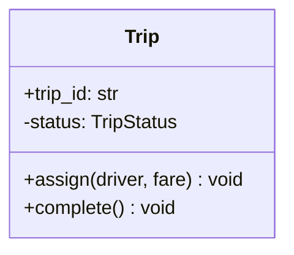
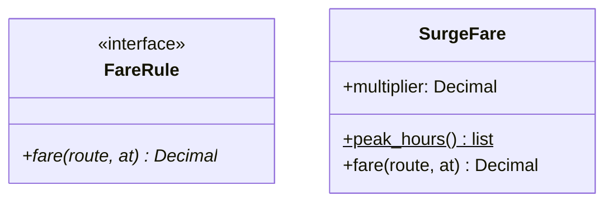
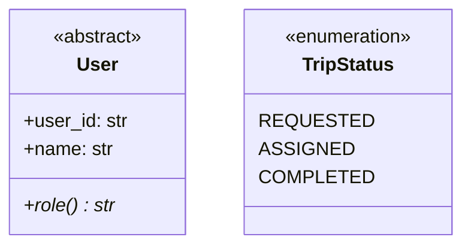
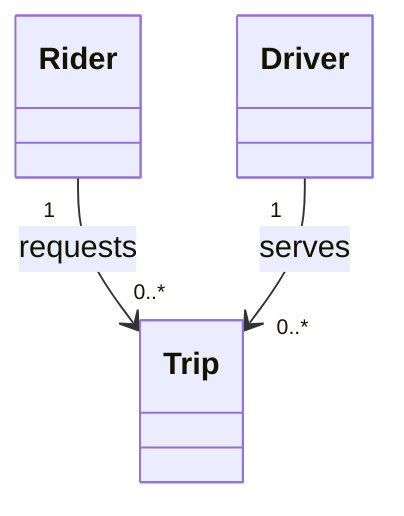

# UML class diagrams

A class diagram is the main artifact of an LLD round. It fixes the vocabulary both sides use for the rest of the interview, and it is the thing pointed at when a design choice is questioned. Producing correct notation quickly matters more than producing a lot of it: a small accurate diagram supports a discussion, while a large one full of notation errors invites corrections instead of questions about the design.

This note covers the notation that has to come from memory, how much detail is enough under time pressure, and the notation mistakes that cost credibility. What the relationships mean is in [note 05](05-class-relationships.md); this note covers how to draw them.

## The class box

A class is a rectangle with up to three compartments: name, attributes, operations. The lower two can be omitted when they add nothing.

## Visibility

Every attribute and operation carries a visibility marker. Omitting markers is a common shortcut, but they are cheap to write and are part of what the diagram is being read for.

| Marker | Visibility | Python convention |
| ------ | ---------- | ----------------- |
| `+`    | Public     | `name`            |
| `-`    | Private    | `__name`          |
| `#`    | Protected  | `_name`           |
| `~`    | Package    | no equivalent     |

Python has no enforced access control, so `-` and `#` on a Python diagram describe intent rather than a language guarantee ([note 04](04-oop-core-concepts.md)). Saying that out loud when the diagram is drawn is worth the two seconds.

## Attributes and operations

The full forms are `visibility name: Type [multiplicity] = default` for attributes and `visibility name(parameter: Type): ReturnType` for operations. Most of that is optional, and in an interview most of it is dropped.

Two conventions carry meaning beyond the text:

- Static members are underlined.
- Abstract members are italic.

Types on parameters are usually skipped on a whiteboard and kept on a screen where typing is cheap. Return types are worth keeping either way, because they show what a collaboration produces.

## Abstract classes and interfaces

Both are drawn as class boxes with a stereotype above the name: `«abstract»` or `«interface»`. `<<enumeration>>` is also available and is worth using for status types, which otherwise get mistaken for entities.

## Relationships

The notation is the part most often drawn wrong, and it is checked, because each line style carries a claim about lifetime and ownership.

| Relationship   | Drawing | Marker                        | Marker sits at |
| -------------- | ------- | ----------------------------- | -------------- |
| Generalization | `────▷` | Hollow triangle               | Superclass     |
| Realization    | `╌╌╌╌▷` | Hollow triangle               | Interface      |
| Composition    | `◆────` | Filled diamond                | Whole          |
| Aggregation    | `◇────` | Hollow diamond                | Whole          |
| Association    | `────>` | Open arrowhead (if navigable) | Target         |
| Dependency     | `╌╌╌╌>` | Open arrowhead                | Supplier       |

Two rules cover most of the errors. Triangles point at the more general thing, the superclass or the interface. Diamonds sit at the whole, never at the part.

## Multiplicity

Multiplicity is written as a quoted string at each end of a relationship.

| Notation      | Meaning                    |
| ------------- | -------------------------- |
| `1`           | Exactly one                |
| `0..1`        | Optional, at most one      |
| `*` or `0..*` | Any number, including none |
| `1..*`        | At least one               |
| `2..4`        | Between two and four       |

### Reading multiplicity

The number sits at the far end from the class it describes. In `Rider "1" --> "0..*" Trip`, the `0..*` next to `Trip` means one rider has zero or more trips, and the `1` next to `Rider` means each trip belongs to exactly one rider.

Getting this backwards reverses the model, and it is a fast thing for an interviewer to check. Reading each relationship aloud as a sentence in both directions catches it: "one rider has many trips, one trip has one rider".

Multiplicity is worth writing only where it drives the code. `0..1` says a field is nullable and every reader has to handle the empty case. `1..*` says a collection must never be empty, which is an invariant some constructor has to enforce. A `1` that nobody would have doubted adds nothing.

## Association labels and roles

An association can carry a verb phrase naming what it means, and role names at each end naming the part each class plays. Labels are most useful when two classes are connected more than once, where the lines are otherwise indistinguishable. The verb phrase reads in the direction of the arrow.

## How much detail is enough

The diagram is judged on whether it supports the discussion, not on completeness.

Worth drawing:

- Every class from the object-modeling phase, even those with an empty body.
- All relationships, with the correct line style.
- Multiplicity wherever it is not obvious or wherever it constrains the code.
- Stereotypes on interfaces, abstract classes, and enumerations.
- The public operations that appear in the flows being walked.

Not worth drawing:

- Getters, setters, and constructors.
- Private helpers.
- Every attribute. Identity fields and anything read during a flow are enough.
- Exception classes.
- Parameter types

Drawing in passes keeps the diagram usable throughout: boxes and names first, relationships second, members last, then refinements while walking the flows. A diagram that exists in outline at minute ten is worth more than a perfect one at minute thirty.

## Notation mistakes that cost credibility

- Generalization arrowhead at the subclass. The triangle always points at the superclass.
- Realization drawn with a solid line. Solid plus triangle is generalization; the dashed line is what distinguishes implementing an interface from extending a class.
- Dependency drawn with a solid line, which turns a transient use into a permanent structural link.
- A filled diamond on something clearly shared. Composition claims the part dies with the whole, and a shared part contradicts it immediately.
- A diamond on the part rather than the whole, which inverts ownership.
- Multiplicity at the wrong end, which reverses the model.
- Inheritance used for "has-a". A `Trip` is not a kind of `Route`.
- Interfaces with one implementation and no second one in sight, which adds a box without adding a decision.
- Classes left floating with no relationship to anything, which usually means the class was named but never placed in the design.
- Every attribute and accessor listed, so the relationship lines get lost in the noise.
