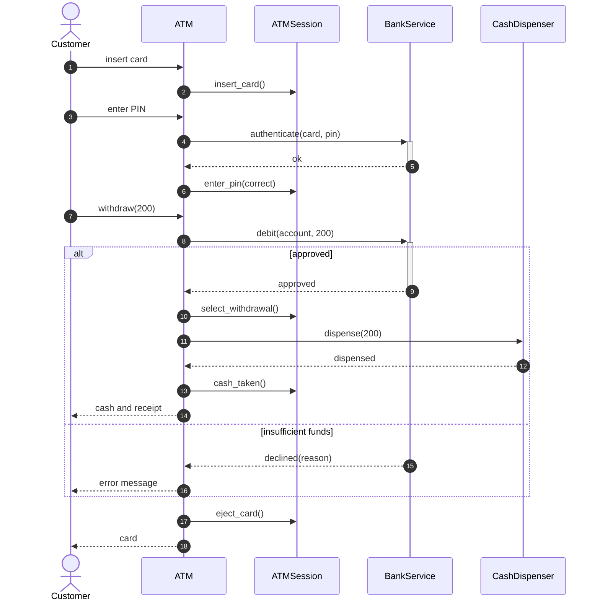
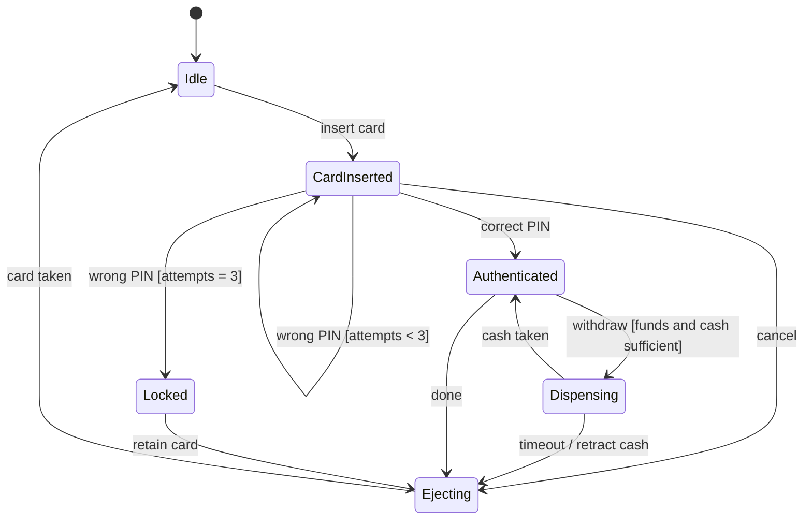
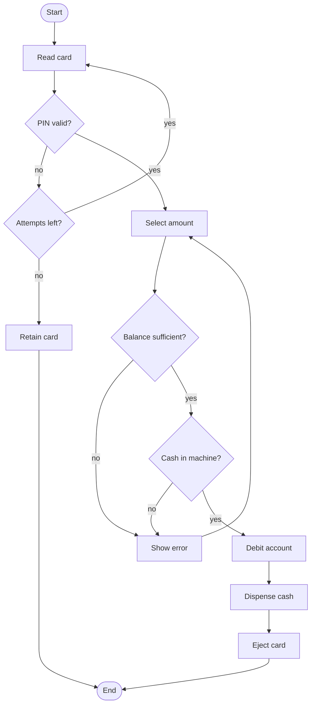

# UML behavioral diagrams

A class diagram shows what exists and how it is connected. It cannot show order, timing, or the rules about which operations are legal when. Those gaps are where behavioral diagrams earn their place, and where most design flaws are found: a flow that no class can carry, a state that nothing prevents, an object that only forwards calls.

Three types matter in an LLD round. Sequence diagrams walk a use case through the objects. State diagrams describe the lifecycle of one object. Activity diagrams describe a process with branches. This note covers the notation for each and the judgment about which one is worth the minutes it costs.

All examples use one domain: an ATM with cards, PIN authentication, a bank service, and a cash dispenser.

## Choosing a diagram

| Diagram  | Answers                                               | Reach for it when                     |
| -------- | ----------------------------------------------------- | ------------------------------------- |
| Sequence | Which object calls which, in what order               | Walking a use case through the design |
| State    | Which states an object has, and which moves are legal | The domain object has a lifecycle     |
| Activity | Which steps a process takes, and where it branches    | The branching is the interesting part |

In practice the ranking is stable: sequence diagrams are drawn in most rounds, state diagrams whenever the domain has a lifecycle, and activity diagrams rarely.

## Sequence diagrams

A sequence diagram shows objects as vertical lifelines and messages as horizontal arrows between them, with time running downwards. It belongs in phase 4 of the runbook, where the design is proved by tracing a flow through it ([note 01](01-interview-playbook.md)).

### Notation

- A lifeline is one object or role, drawn as a box at the top with a dashed line below it. Lifelines are objects, not classes and not methods.
- An activation bar is the thin rectangle on a lifeline showing that the object is executing. Useful for showing nesting, optional when the flow is shallow.
- A synchronous call is a solid line with a filled arrowhead. The caller waits.
- A return is a dashed line with an open arrowhead. Returns are drawn only when the returned value matters to the story.
- An asynchronous message is a solid line with an open arrowhead, and the caller does not wait.
- Object creation is an arrow pointing at a lifeline box drawn lower down the page and destruction is an `X` at the end of a lifeline.
- Combined fragments box a region and label it: `alt` for branches, `opt` for a conditional block, `loop` for repetition, `par` for concurrent regions.

### Cash withdrawal



The diagram makes the design's division of labour visible: `ATM` coordinates, `ATMSession` owns the state, `BankService` owns the money, and `CashDispenser` owns the hardware. Nothing reaches through another object to get at a third.

### What a sequence diagram exposes

- A message no class can send, because the data it needs lives somewhere else. This is the cheapest possible time to discover a missing relationship.
- An object that only forwards, receiving a call and passing it straight on without adding anything. Sometimes a justified facade, often a class that should not exist.
- A chain of calls reaching through objects, `a.b().c().d()`, which is the Law of Demeter violation made visual ([note 08](08-coupling-and-cohesion.md)).
- A lifeline that appears in every flow and does most of the work, which is a god object seen from the side ([note 03](03-object-modeling.md)).

### How much detail

One flow per diagram, four to six lifelines, the happy path plus the one failure branch that changes the design. A second diagram is only worth drawing when a flow uses a different set of collaborators than the first.

Returns for every call double the arrows and add little. Drawing them only where the caller branches on the result keeps the diagram readable.

## State diagrams

A state diagram describes one object's lifecycle: the states it can be in, the events that move it between them, and by omission, the moves that are illegal. The omissions are the point. A state diagram is the compact way to say that a booking cannot be paid twice or that an ATM cannot dispense cash before authentication.

### Notation

- A state is a rounded rectangle. States are named for the condition the object is in, not for the action that got it there.
- The initial pseudostate is a filled circle with an arrow to the first real state. The final state is a filled circle inside a ring.
- A transition is an arrow labelled `trigger [guard] / action`. The trigger is the event, the guard is a condition that must hold, and the action runs during the transition. All three parts are optional.
- Entry and exit actions are written inside the state as `entry / action` and `exit / action`, for work that must happen no matter which transition arrives or leaves.
- A composite state nests a state machine inside one state, which collapses a group of states that all share the same outgoing transition.

### The ATM session



The machine has no final state, which is normal for a long-lived controller: the session returns to `Idle` and waits for the next card. Naming that explicitly is better than drawing a final state that the object never reaches.

Two things on this diagram are worth more than the states themselves. The self-transition on `CardInserted` with a guard shows where the retry counter lives. The `Dispensing --> Ejecting` transition on timeout is the failure path that an interviewer will ask about, and having it on the diagram already answers the question.

### From state diagram to code

The direct translation is an enum plus a table of allowed transitions, with one private method enforcing it. Every public operation goes through that method, so an illegal move fails in one place rather than in whichever method forgot to check.

```python
from enum import Enum

MAX_PIN_ATTEMPTS = 3


class SessionState(Enum):
    IDLE = "idle"
    CARD_INSERTED = "card_inserted"
    AUTHENTICATED = "authenticated"
    DISPENSING = "dispensing"
    EJECTING = "ejecting"
    LOCKED = "locked"


class IllegalTransition(Exception):
    pass


_ALLOWED: dict[SessionState, set[SessionState]] = {
    SessionState.IDLE: {SessionState.CARD_INSERTED},
    SessionState.CARD_INSERTED: {
        SessionState.AUTHENTICATED,
        SessionState.EJECTING,
        SessionState.LOCKED,
    },
    SessionState.AUTHENTICATED: {SessionState.DISPENSING, SessionState.EJECTING},
    SessionState.DISPENSING: {SessionState.AUTHENTICATED, SessionState.EJECTING},
    SessionState.LOCKED: {SessionState.EJECTING},
    SessionState.EJECTING: {SessionState.IDLE},
}


class ATMSession:
    def __init__(self) -> None:
        self._state = SessionState.IDLE
        self._attempts = 0

    @property
    def state(self) -> SessionState:
        return self._state

    def insert_card(self) -> None:
        self._move_to(SessionState.CARD_INSERTED)
        self._attempts = 0

    def enter_pin(self, correct: bool) -> None:
        if self._state is not SessionState.CARD_INSERTED:
            raise IllegalTransition(f"cannot enter a PIN while {self._state.value}")
        if correct:
            self._move_to(SessionState.AUTHENTICATED)
            return
        self._attempts += 1
        if self._attempts >= MAX_PIN_ATTEMPTS:
            self._move_to(SessionState.LOCKED)

    def select_withdrawal(self) -> None:
        self._move_to(SessionState.DISPENSING)

    def cash_taken(self) -> None:
        self._move_to(SessionState.AUTHENTICATED)

    def eject_card(self) -> None:
        self._move_to(SessionState.EJECTING)

    def card_taken(self) -> None:
        self._move_to(SessionState.IDLE)

    def _move_to(self, target: SessionState) -> None:
        if target not in _ALLOWED[self._state]:
            raise IllegalTransition(f"{self._state.value} -> {target.value}")
        self._state = target
```

The transition table suits a machine where the states differ in what is allowed but not in how the work is done. When each state needs genuinely different behavior for the same operation, the State pattern replaces the table with one class per state, trading a larger class count for the removal of the conditionals.

### When it is worth the time

Anything with a lifecycle and illegal moves: orders, bookings, trips, elevators, vending machines, document approval. In those domains the state diagram is often more valuable than a second sequence diagram, because it is the compact statement of the rules.

Commonly probed follow-up: what happens on the interruption nobody designed for. Card withdrawn mid-transaction, network failure after the debit, power loss while dispensing. The answer is a transition, and a diagram that already has one failure path makes it easy to add another.

## Activity diagrams

An activity diagram is a flowchart with UML notation: rounded rectangles for actions, diamonds for decisions and merges, bars for forking and joining concurrent flows, a filled circle for the start and a ringed circle for the end. Swimlanes partition the actions by who performs them.



### When it is a distraction

Most of the time. The diagram above says nothing about which class does what, and that is the question an LLD round is asking. The same branching fits inside a sequence diagram as `alt` fragments, where it also shows the collaboration.

Activity diagrams earn their place in two narrow cases: a process with genuinely concurrent branches that fork and join, and a multi-party workflow where swimlanes make the handoffs visible. Outside those, the minutes are better spent on the class diagram.

## Which to draw in a round

- Always: one sequence diagram for the primary flow, drawn while walking it.
- Usually: a state diagram, whenever a core entity has more than two states.
- Rarely: an activity diagram, and only when concurrency or handoffs are the subject.

A diagram drawn while talking is worth more than one drawn in silence. The purpose is to make the reasoning visible, so each arrow should arrive with the sentence that justifies it.

## Common mistakes

- Lifelines that are methods rather than objects, which turns a sequence diagram into a call stack.
- A lifeline per class where several instances of the same class participate, which hides the fact that the flow touches more than one.
- Return arrows for every message, so the interesting ones stop standing out.
- States named for actions (`Dispensing cash to the customer`) mixed with states named for conditions, which quietly turns a state diagram into an activity diagram.
- States that are really attribute values. A state earns its place only if it changes which operations are legal; otherwise it is a field.
- Missing failure transitions. A state machine with only the happy path is the same design flaw as a sequence diagram with no `alt`.
- Drawing the actor's internal steps. The diagram models the system, and the customer deciding how much to withdraw is not part of it.
- A state diagram covering the whole system rather than one object. A state machine describes one lifecycle; several interacting objects need several diagrams.
