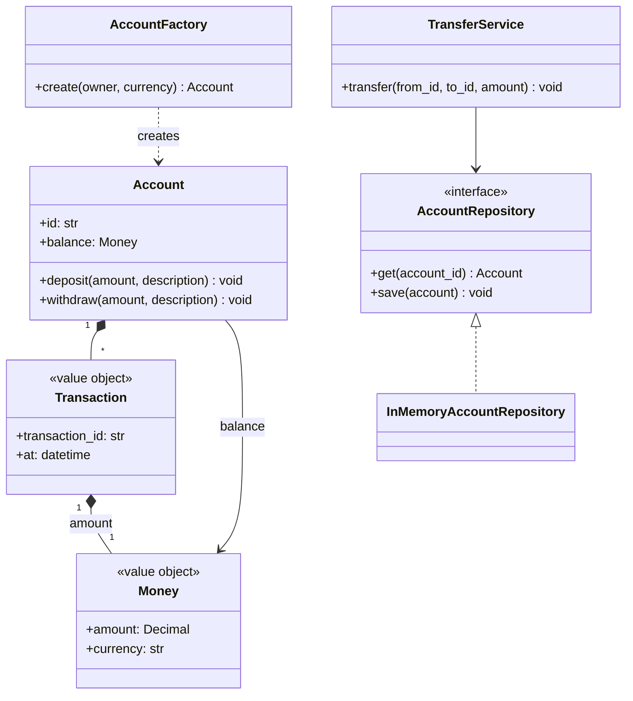

# Domain modeling

Object modeling ([note 03](03-object-modeling.md)) produces a first set of classes from requirements. Domain modeling is the second pass: distinguishing objects that carry identity from objects that carry values, grouping the ones that enforce invariants together, and keeping the domain free of infrastructure concerns.

The vocabulary is from tactical domain-driven design, kept at the subset useful in an interview: entities, value objects, aggregates, repositories, domain services, and factories.

All examples use one domain: a bank account system where customers hold accounts and transfer money between them.

## Entities

An entity is an object identified by a stable identifier, not by its attributes. Two accounts at the same balance, held by the same customer, are still different accounts — they have different IDs. Mutating an entity's attributes does not change what it is.

In code, an entity has a unique identity field and equality by ID:

```python
class Account:
    def __init__(self, account_id: str, owner: str, currency: str) -> None:
        self._id = account_id
        self._owner = owner
        self._currency = currency

    def __eq__(self, other: object) -> bool:
        if not isinstance(other, Account):
            return NotImplemented
        return self._id == other._id

    def __hash__(self) -> int:
        return hash(self._id)
```

Entities are mutable. Their state changes over their lifetime but their identity does not.

## Value objects

A value object is identified entirely by its value. Two `Money(Decimal("100"), "USD")` instances are the same thing and there is no meaningful distinction between them. Values should be immutable: operations return new values rather than mutating in place. Immutability makes them safe to share without defensive copying.

Common examples: `Money`, `Address`, `DateRange`, `Coordinate`, `Email`.

```python
from dataclasses import dataclass
from decimal import Decimal


@dataclass(frozen=True)
class Money:
    amount: Decimal
    currency: str

    def __add__(self, other: Money) -> Money:
        if self.currency != other.currency:
            raise ValueError(f"currency mismatch: {self.currency} vs {other.currency}")
        return Money(self.amount + other.amount, self.currency)

    def __sub__(self, other: Money) -> Money:
        if self.currency != other.currency:
            raise ValueError(f"currency mismatch: {self.currency} vs {other.currency}")
        return Money(self.amount - other.amount, self.currency)
```

`@dataclass(frozen=True)` gives immutability, structural equality, and `__hash__` for free.

### The primitive obsession trap

Storing `balance: Decimal` without a currency makes every method that computes with it an implicit assumption that all balances share the same currency. When that assumption breaks, the error surfaces far from where the value was stored. A `Money` value object makes the currency explicit and catches mismatches at the arithmetic step.

The same argument applies to any primitive that carries a unit or a constraint: a string that must be a valid IBAN, a float that represents latitude, a positive integer representing an item count. Each is a candidate for a value object with validation in its constructor.

## Aggregates

An aggregate is a cluster of domain objects that enforce consistency together. One object is the **aggregate root**: the only entry point from outside the cluster. All state changes go through the root, so invariants that span the cluster are enforced in one place.

The account is an aggregate root. Its balance and transaction history are maintained together, and the invariant — balance cannot fall below the overdraft limit — must hold after every operation.

```python
from dataclasses import dataclass
from datetime import datetime
from decimal import Decimal
from uuid import uuid4


@dataclass(frozen=True)
class Transaction:
    transaction_id: str
    amount: Money
    description: str
    at: datetime


class InsufficientFunds(Exception):
    pass


class Account:
    def __init__(
        self,
        account_id: str,
        owner: str,
        currency: str,
        overdraft_limit: Decimal = Decimal(0),
    ) -> None:
        self._id = account_id
        self._owner = owner
        self._balance = Money(Decimal(0), currency)
        self._overdraft_limit = overdraft_limit
        self._history: list[Transaction] = []

    @property
    def id(self) -> str:
        return self._id

    @property
    def balance(self) -> Money:
        return self._balance

    def deposit(self, amount: Money, description: str = "") -> None:
        if amount.amount <= 0:
            raise ValueError("deposit amount must be positive")
        self._record(amount, description)

    def withdraw(self, amount: Money, description: str = "") -> None:
        if amount.amount <= 0:
            raise ValueError("withdrawal amount must be positive")
        resulting = self._balance.amount - amount.amount
        if resulting < -self._overdraft_limit:
            raise InsufficientFunds(
                f"balance {self._balance.amount} with limit {self._overdraft_limit} < {amount.amount}"
            )
        self._record(Money(-amount.amount, amount.currency), description)

    def _record(self, signed_amount: Money, description: str) -> None:
        txn = Transaction(
            transaction_id=str(uuid4()),
            amount=signed_amount,
            description=description,
            at=datetime.utcnow(),
        )
        self._history.append(txn)
        self._balance = self._balance + signed_amount
```

Every mutation goes through `deposit` or `withdraw`, so the overdraft check is in one place. Outside code cannot reach `_history` directly, so the invariant cannot be bypassed.

### Aggregate boundaries

An aggregate should be as small as possible while still protecting its invariants. A common mistake is to grow an aggregate until it becomes a god object: if `Account` owned a collection of `Customer` objects, every operation on a customer would load the whole account. The practical rule: one aggregate per transaction boundary. A money transfer touches two accounts, but neither owns the other and a service coordinates them instead.

## Repositories

A repository is the interface between the domain and storage. The domain defines the repository as a pure interface and calls it while the infrastructure supplies the implementation. The domain never knows whether the backing store is a relational database, a document store, or memory.

```python
from typing import Protocol


class AccountRepository(Protocol):
    def get(self, account_id: str) -> Account | None: ...
    def save(self, account: Account) -> None: ...
    def find_by_owner(self, owner: str) -> list[Account]: ...


class InMemoryAccountRepository:
    def __init__(self) -> None:
        self._store: dict[str, Account] = {}

    def get(self, account_id: str) -> Account | None:
        return self._store.get(account_id)

    def save(self, account: Account) -> None:
        self._store[account.id] = account

    def find_by_owner(self, owner: str) -> list[Account]:
        return [a for a in self._store.values() if a._owner == owner]
```

At interview scope, the in-memory implementation is always sufficient. The point is the interface: the domain calls `repo.get()`, and swapping the implementation is an infrastructure decision with no impact on domain code.

### What belongs in a repository

A repository handles one aggregate type. It retrieves and persists complete aggregates, not individual parts. `AccountRepository.get()` returns a full `Account` and it does not return a `Transaction` in isolation. If transactions need to be queried independently — by date range, by counterparty — they need their own repository, and the aggregate boundary may need revisiting.

## Domain services

A domain service holds logic that belongs to the domain but does not naturally fit any single entity or value object. The common signal: the operation spans multiple aggregates, or it has no clear home in any one object.

A transfer is the canonical example. Moving money between two accounts is a domain concept, but it belongs to neither account: the source does not own the target, and the target does not own the source.

```python
class TransferService:
    def __init__(self, repo: AccountRepository) -> None:
        self._repo = repo

    def transfer(self, from_id: str, to_id: str, amount: Money) -> None:
        source = self._repo.get(from_id)
        target = self._repo.get(to_id)
        if source is None:
            raise ValueError(f"account not found: {from_id}")
        if target is None:
            raise ValueError(f"account not found: {to_id}")
        source.withdraw(amount, f"transfer to {to_id}")
        target.deposit(amount, f"transfer from {from_id}")
        self._repo.save(source)
        self._repo.save(target)
```

The overdraft check happens inside `source.withdraw()`, where the aggregate enforces it. The service coordinates and the aggregate enforces. Neither responsibility leaks into the other.

Commonly probed follow-up: atomicity. If `save(source)` succeeds and `save(target)` fails, the transfer is partially applied. At interview scope, "this is why the two saves need to be inside a database transaction" is sufficient, and naming the repository as the transactional boundary shows awareness of the layer separation without overcomplicating the design.

## Factories

A factory encapsulates complex object construction. When building an aggregate requires generating IDs, validating initial state, or coordinating between parts, a factory keeps that complexity out of the aggregate's own constructor.

```python
from uuid import uuid4


class AccountFactory:
    def create(
        self, owner: str, currency: str, overdraft_limit: Decimal = Decimal(0)
    ) -> Account:
        return Account(
            account_id=str(uuid4()),
            owner=owner,
            currency=currency,
            overdraft_limit=overdraft_limit,
        )
```

A factory earns its place when construction is non-trivial: choosing between subtypes, applying configuration defaults, or coordinating two objects at creation time. When a single constructor call is enough, a factory adds ceremony without adding clarity.

## The account model



## Rich versus anemic domain models

An anemic model keeps entities as data containers and puts all logic in service classes. The entity `Account` has public fields and no methods while `AccountService` contains `withdraw`, `deposit`, and `transfer`.

The problem: `AccountService` has no access to `Account`'s private state. The overdraft invariant must be checked in the service, and every service that touches accounts must remember to check it. An entity that cannot protect its own invariants is not protecting anything.

The test: if an entity's constructor and properties could be `@dataclass` fields and every method could move to a service without breaking the design, the model is anemic. The methods that enforce the aggregate's invariants belong on the aggregate.

Commonly probed follow-up: is a rich domain model always better? No. A thin CRUD service — where the domain amounts to "store this and retrieve it" — has no invariants to enforce, and an anemic model with a repository is the right fit. The rich model pays off when the domain has meaningful rules that must hold across state changes.

## Persistence boundaries

The domain should not import ORMs, database libraries, or serialization frameworks. `Account` should not inherit from `sqlalchemy.Base` or `django.db.models.Model`. When the domain is independent of infrastructure, it can be tested without a database, and swapping the persistence layer is an infrastructure decision that does not touch domain code.

The boundary: `AccountRepository` is a `Protocol` in the domain layer. An ORM-backed implementation lives in the infrastructure layer and imports from both. The domain imports nothing from the infrastructure layer.

This boundary is also the one most worth stating at a round: "the repository interface belongs to the domain and the database implementation belongs to infrastructure." It directly answers "how do you keep the domain clean?" and it explains why the in-memory implementation is a complete stand-in for testing — no mocking required.
