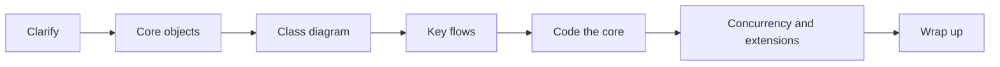
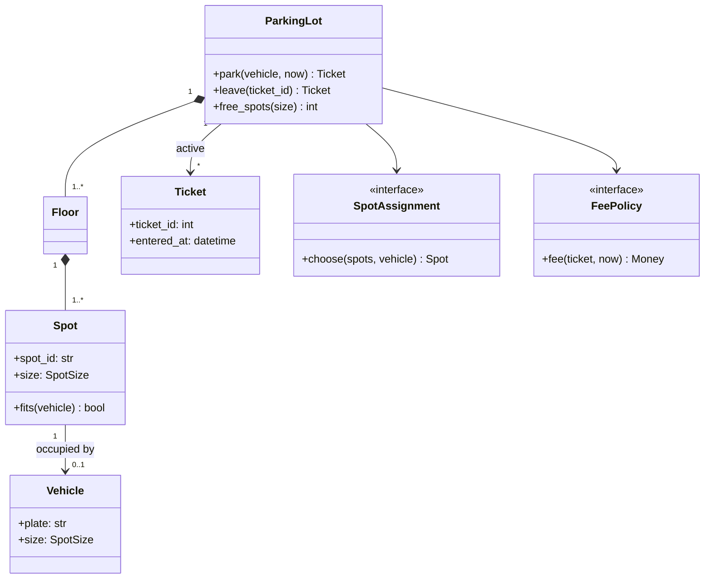

# Interview playbook

A low-level design (LLD) round asks for a class-level design of a bounded problem: which objects exist, what each is responsible for, how they collaborate, and enough code to show the design holds up. It rewards a visible, structured process as much as the final design. A reasonable design reached in an orderly way scores better than a clever one reached by jumping around.

This is the note to re-read immediately before an interview. It covers the round formats, what is scored, a phase-by-phase runbook with time boxes, and an end-of-round checklist.

All examples use one domain: a parking lot with spots of different sizes, vehicles, and tickets.

## Round formats

- Diagram-only: Requirements, a class diagram, and one or two walked-through flows, with little or no code. The diagram carries the whole design, so relationships, multiplicities, and interfaces need to be accurate ([note 06](06-uml-class-diagrams.md)). Sequence diagrams are the main tool for showing behavior ([note 07](07-uml-behavioral-diagrams.md)).
- Code-it-out: A shared editor, only the core is expected in code. The main classes, their key methods, and one or two flows end to end. Stubs and `...` bodies for peripheral pieces are normal and should be named as such.
- Machine coding: The code must run. Expect an in-memory store, a small driver or `main` that exercises the flows, and clean separation between domain code and input handling. Tests help if time allows. Code quality is judged more strictly than in any other format.
- Extend an existing design: An existing codebase or diagram plus a new requirement. The scoring shifts to reading code, finding the right seam, and making a minimal change that preserves existing behavior. Rewriting what already works is the main failure mode.

The format is usually stated up front. If not, ask whether working code is expected and how much of the time should go to it.

## Scope of an LLD answer

The unit of design is the class, and the whole model runs in one process with in-memory storage. Sharding, caching layers, message queues, and load balancers are out of place unless the interviewer brings them up. Concurrency within the process is in scope ([note 13](13-concurrency.md)), and distribution across machines is not. [Note 02](02-requirements-and-scoping.md#non-functional-constraints-at-this-level) draws that line in more detail.

## What is scored

Most rubrics reduce to five areas. Each has a recognizable strong and weak signal.

- Requirements handling. Strong: asks targeted questions, writes down a bounded scope, and states assumptions before designing. Weak: starts drawing classes immediately, or asks twenty questions without converging. See [note 02](02-requirements-and-scoping.md).
- Abstraction quality. Strong: classes map to domain concepts, each has a clear responsibility, and abstractions sit where the requirements vary. Weak: a god class (`ParkingLotManager` doing everything), anemic data classes with logic elsewhere, or interfaces with one implementation and no reason to exist. See [note 03](03-object-modeling.md).
- Extensibility. Strong: a new vehicle type or pricing rule is a new class, not an edit to a conditional. The design names its extension points. Weak: `if vehicle_type == ...` spread across the code. See [note 11](11-solid-principles.md).
- Code hygiene. Strong: clear names, small methods, explicit errors, no dead code. Weak: long methods, magic numbers, `dict`-shaped objects passed around instead of types.
- Communication. Strong: thinks out loud, checks in at phase boundaries, and names trade-offs ("a list is fine at this size; a spot index by size is the change if lookups get slow"). Weak: long silences, or defending a choice without giving the reason.

Communication runs through all the others. A good decision that is never explained gets little credit.

## The runbook



Time boxes for the two common lengths:

| Phase                         | 45 min | 90 min |
| ----------------------------- | ------ | ------ |
| 1. Clarify requirements       | 5      | 8      |
| 2. Identify core objects      | 5      | 10     |
| 3. Class diagram              | 8      | 12     |
| 4. Walk key flows             | 5      | 10     |
| 5. Code the core              | 15     | 40     |
| 6. Concurrency and extensions | 5      | 8      |
| 7. Wrap up                    | 2      | 2      |

For a diagram-only round, fold phase 5's time into phases 3 and 4. The time boxes are guides. The rule that matters is never to reach the last ten minutes without the core flow designed end to end.

### 1. Clarify requirements

Goal: turn the one-line prompt into a short written list of what the system must do and what it will not do.

- Identify the actors (driver, attendant, admin) and the main use cases (enter, park, pay, exit).
- Ask about the rules that shape the model: spot sizes, which vehicles fit where, how fees are computed, multiple floors or entrances.
- Write the result as a short list of functional requirements, then an explicit out-of-scope line and the assumptions made.

For the parking lot, the result might read:

```plaintext
- In scope:
  - multiple floors
  - compact/regular/large spots
  - motorcycles, cars, vans
  - issue ticket on entry
  - hourly fee on exit
  - show free spots per size
- Out of scope:
  - reservations
  - payments integration
  - license-plate cameras
  - multiple lots
- Assume:
  - a vehicle fits its own size or larger
  - one entrance and one exit
```

Common failure: skipping this phase. Every later decision depends on it, and an unstated assumption the interviewer disagrees with can invalidate the whole design. [Note 02](02-requirements-and-scoping.md) has the question banks.

### 2. Identify core objects

Goal: a list of candidate classes, each with a one-line responsibility.

Extract nouns from the requirements and filter them: `ParkingLot`, `Floor`, `Spot`, `Vehicle`, `Ticket`, `FeePolicy`. Separate entities (have identity and a lifecycle: `Spot`, `Ticket`) from value objects (defined by their values: `SpotSize`, `Money`). Name the places where behavior varies, since those are where interfaces go: spot assignment rules and fee calculation. [Note 03](03-object-modeling.md) covers the technique.

Common failure: modeling the actors as classes that do the work (`Attendant.park_car()`). Actors usually map to use cases, not to classes that hold logic.

### 3. Class diagram

Goal: classes, key attributes and methods, relationships, and multiplicities on a diagram both sides can point at.



Enough detail means: every class from phase 2, the relationships with the right type ([note 05](05-class-relationships.md)), multiplicities where they drive the code, and the public methods of the main classes. Private helpers and getters do not belong on it.

Common failure: spending twenty minutes perfecting notation. The diagram is a communication tool. Draw it quickly, then refine it while walking flows.

### 4. Walk key flows

Goal: prove the design works by tracing the main use cases through it, method call by method call.

For the parking lot, trace entry (`ParkingLot.park` asks `SpotAssignment` for a spot, marks it occupied, issues a `Ticket`) and exit (`ParkingLot.leave` looks up the ticket, frees the spot, asks `FeePolicy` for the fee). A sequence diagram helps for anything with more than three collaborators ([note 07](07-uml-behavioral-diagrams.md)).

This phase finds missing pieces cheaply. A flow that needs data no class holds, or a method no class naturally owns, shows up here rather than halfway through coding.

### 5. Code the core

Goal: the main classes and one or two flows, end to end, in clean code.

Start from the entry point and the domain types. Code the parts that carry the design (the core flow and one extension seam), and stub the rest. A compact version of the parking lot core, with floors and fees left out:

```python
import itertools
from dataclasses import dataclass
from datetime import datetime
from enum import Enum
from typing import Protocol


class SpotSize(Enum):
    COMPACT = 1
    REGULAR = 2
    LARGE = 3


@dataclass(frozen=True)
class Vehicle:
    plate: str
    size: SpotSize


@dataclass
class Spot:
    spot_id: str
    size: SpotSize
    vehicle: Vehicle | None = None

    def fits(self, vehicle: Vehicle) -> bool:
        return self.vehicle is None and self.size.value >= vehicle.size.value


@dataclass(frozen=True)
class Ticket:
    ticket_id: int
    plate: str
    spot_id: str
    entered_at: datetime


class SpotAssignment(Protocol):
    def choose(self, spots: list[Spot], vehicle: Vehicle) -> Spot | None: ...


class FirstFit:
    def choose(self, spots: list[Spot], vehicle: Vehicle) -> Spot | None:
        return next((spot for spot in spots if spot.fits(vehicle)), None)


class LotFull(Exception):
    pass


class ParkingLot:
    def __init__(self, spots: list[Spot], assignment: SpotAssignment) -> None:
        self._spots = {spot.spot_id: spot for spot in spots}
        self._assignment = assignment
        self._active: dict[int, Ticket] = {}
        self._ticket_ids = itertools.count(1)

    def park(self, vehicle: Vehicle, now: datetime) -> Ticket:
        spot = self._assignment.choose(list(self._spots.values()), vehicle)
        if spot is None:
            raise LotFull(f"no spot for {vehicle.plate}")
        spot.vehicle = vehicle
        ticket = Ticket(next(self._ticket_ids), vehicle.plate, spot.spot_id, now)
        self._active[ticket.ticket_id] = ticket
        return ticket

    def leave(self, ticket_id: int) -> Ticket:
        ticket = self._active.pop(ticket_id)
        self._spots[ticket.spot_id].vehicle = None
        return ticket
```

What this shows in a small amount of code:

- One entry point (`ParkingLot`) that coordinates, and domain types that own their own logic (`Spot.fits`).
- An extension seam where the requirements vary (`SpotAssignment`), injected through the constructor.
- Explicit failure (`LotFull`) instead of returning `None` and hoping the caller checks.
- Time passed in (`now`) instead of calling `datetime.now()` inside, which keeps it testable. Fees on exit would follow the same pattern through a `FeePolicy`.

Common failures: coding peripheral classes first (an `Admin` panel before `park` works), writing everything in one class "to refactor later", and going silent while typing. Narrate what each class is for as it is written.

### 6. Concurrency and extensions

Goal: show the design survives the standard follow-ups.

Concurrency: two cars arriving at once can both be handed the same spot, because `choose` then `spot.vehicle = vehicle` is check-then-act. Name the race and the fix (a lock around assignment in `ParkingLot`, or per-floor locks if contention matters). [Note 13](13-concurrency.md) covers the options.

Extensions to expect for the parking lot, and where each lands in the design:

- Electric vehicle spots with chargers: a new spot attribute or subtype, plus an assignment strategy that prefers them.
- Different pricing on weekends: a new `FeePolicy` implementation, no change to `ParkingLot`.
- Reservations: a new `Reservation` entity and a check in `park`. This one does touch the core, and saying so is better than pretending it does not.

The strongest answer to an extension question points at the existing seam it plugs into. When there is no seam, say what would change and why.

### 7. Wrap up

Goal: leave the interviewer with a clear summary.

Recap the design in three or four sentences, name the main trade-offs made, and list what would come next with more time (tests, persistence behind a repository, the out-of-scope features). Asking whether any part of the design should be revisited closes the round on a collaborative note.

## End-of-round checklist

- [ ] Requirements, out-of-scope items, and assumptions were written down, not only discussed.
- [ ] Every class has one clear responsibility that fits in a sentence.
- [ ] No class is named `Manager`, `Handler`, or `Processor` without a specific reason.
- [ ] Interfaces sit exactly where the requirements vary, and nowhere else.
- [ ] Relationships and multiplicities on the diagram match the code.
- [ ] The core flow was traced end to end, in the diagram or in code.
- [ ] Errors are explicit: exceptions or result types, not silent `None`.
- [ ] Shared mutable state was identified, and its thread-safety addressed or explicitly deferred.
- [ ] At least one extension was shown to plug into an existing seam.
- [ ] Trade-offs were stated out loud, with the alternative that was rejected.
